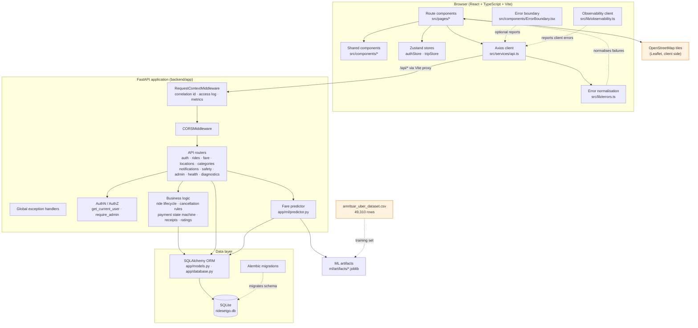
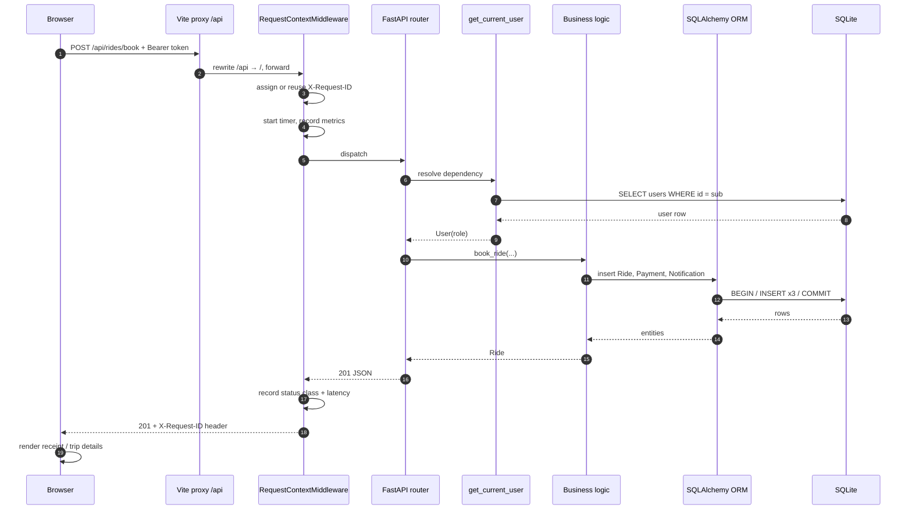
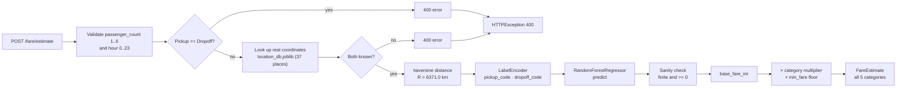
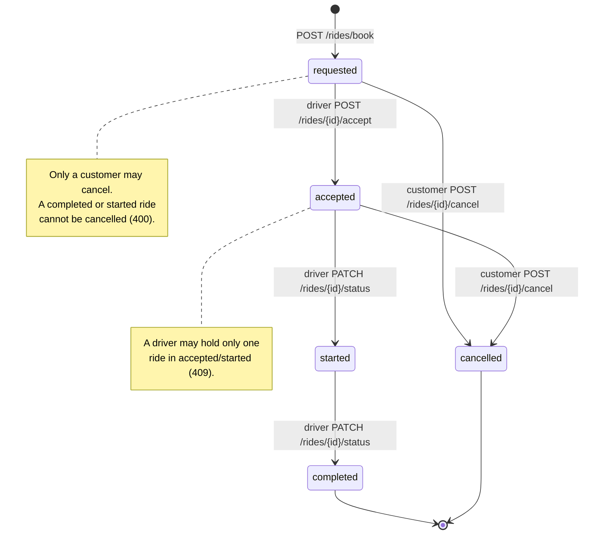
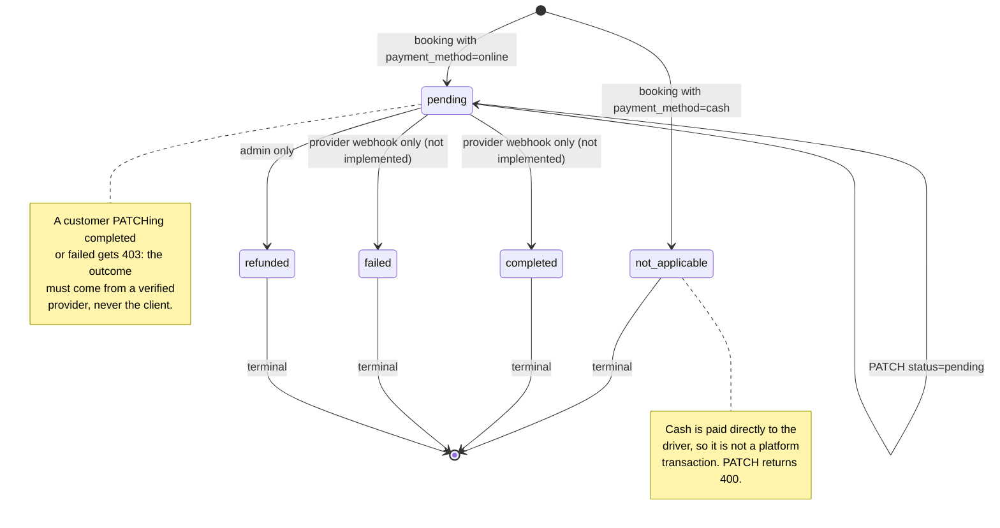
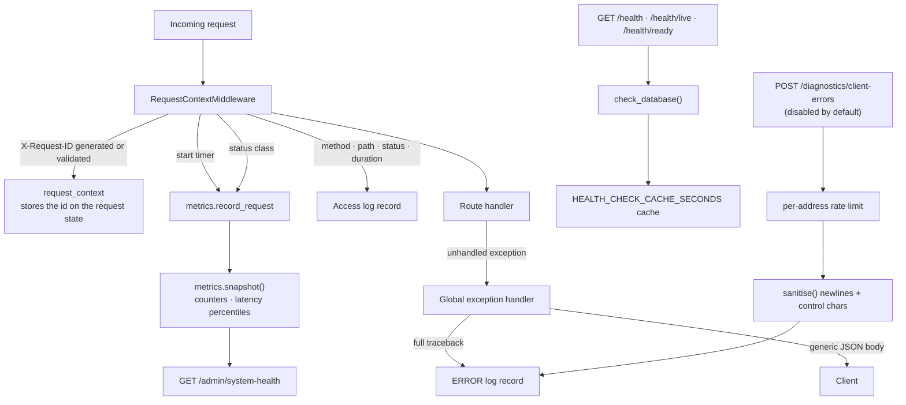
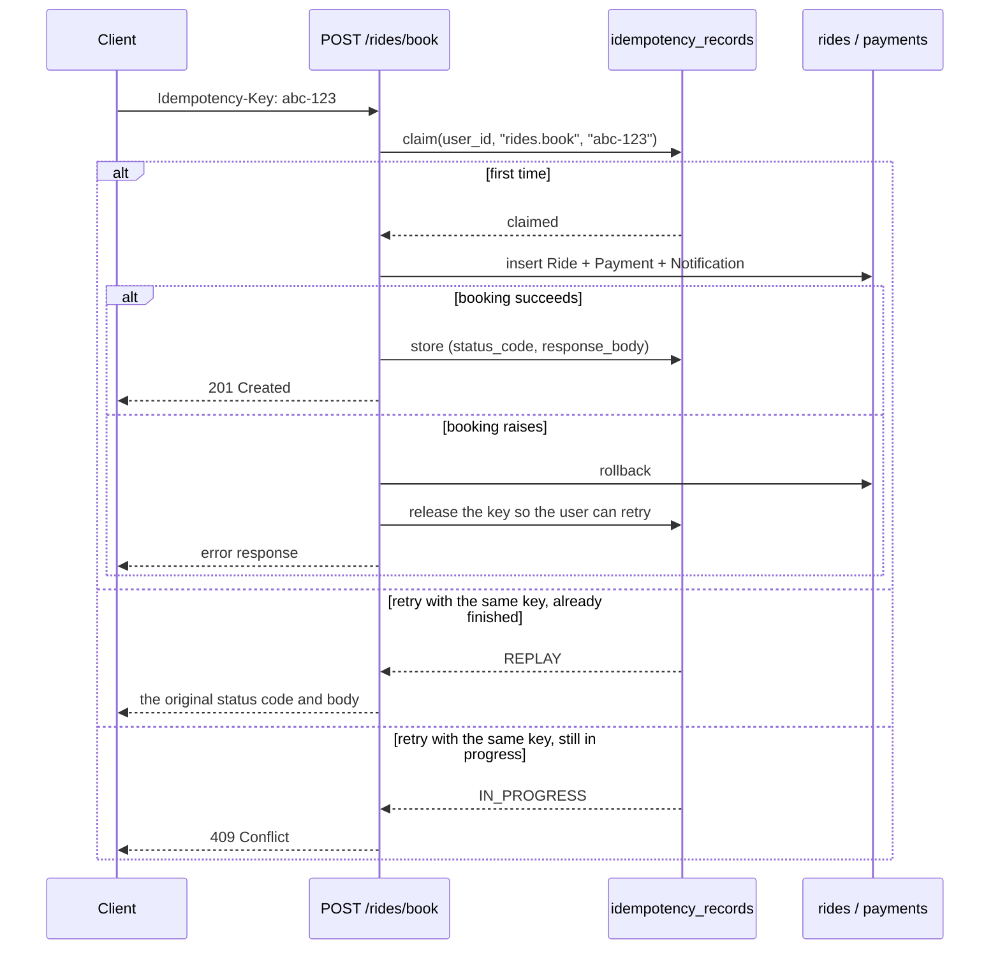
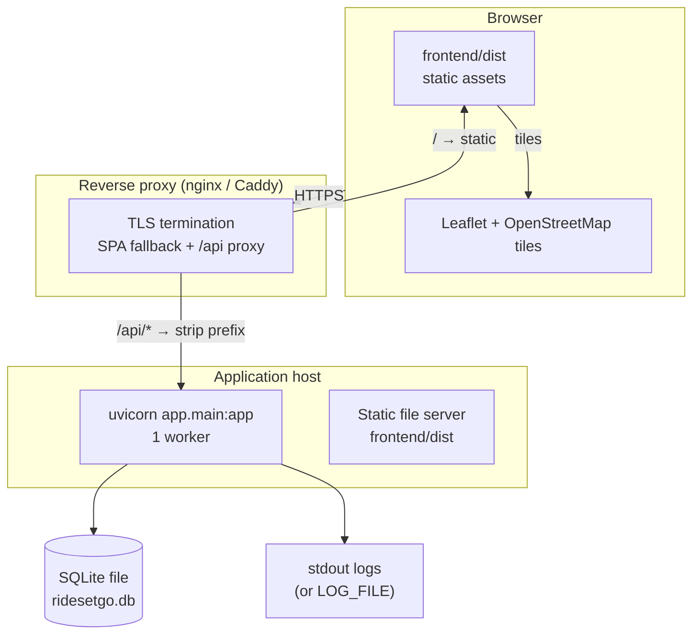

# System Architecture

**RideSetGo** — Amritsar ride-hailing platform with ML fare prediction.

This document describes the architecture that is actually implemented in the
repository. Every component shown here exists in the source tree and was
verified by running the application. Planned or optional integrations are
listed separately in [Not integrated](#not-integrated) so that they are never
mistaken for working parts of the system.

---

## 1. Layer view



**Reading the diagram.** Solid arrows are runtime call paths that exist today.
Dashed arrows are build-time or optional paths. The orange nodes are the only
two external things the system touches: the training CSV (used offline, never
served) and the OpenStreetMap tile server (called directly by Leaflet in the
browser, not proxied through the backend).

---

## 2. Request lifecycle



### Middleware order

`RequestContextMiddleware` is registered **last** in `app/main.py`, so in
Starlette it is the **outermost** layer. It therefore also sees CORS
pre-flight requests, which never reach a route handler. The order is:

```
RequestContextMiddleware  (outermost)
  └── CORSMiddleware
        └── route handler
              └── get_current_user dependency
```

### Authentication and authorisation

| Concern | Implementation | Location |
|---|---|---|
| Password storage | bcrypt via `bcrypt.hashpw` with a per-password salt | `app/core/security.py` |
| Token format | JWT, HS256, `sub` claim = user id, `exp` claim | `app/core/security.py` |
| Token creation | `create_access_token({"sub": str(user.id)})` | `app/core/security.py` |
| Token verification | `decode_access_token` → `jwt.decode` with signature check | `app/core/security.py` |
| Identity resolution | `get_current_user` dependency — decodes the token, loads the user, 401s if missing | `app/api/auth.py` |
| Role gate (admin) | `require_admin` dependency — 403 unless `role == "admin"` | `app/api/admin.py` |
| Role gate (driver) | Inline checks — `role not in ("driver", "admin")` → 403 | `app/api/rides.py` |
| Ownership gate | Inline checks — `ride.user_id != current_user.id` → 403 | `app/api/rides.py` |

Role is a single string column on `users` with the values `customer`, `driver`
and `admin`. There is no separate permission table, and no admin endpoint can
create or promote an account — `scripts/seed_demo_accounts.py` writes the role
directly.

---

## 3. Fare estimation pipeline



### Why the model is honest about distance

`ml/train_model.py` and `ml/pipeline.py` compute distance with **the same
haversine formula** over the **same real coordinates**:

```python
def haversine_km(lat1, lon1, lat2, lon2):
    R = 6371.0
    lat1, lon1, lat2, lon2 = map(np.radians, [lat1, lon1, lat2, lon2])
    dlat = lat2 - lat1
    dlon = lon2 - lon1
    a = np.sin(dlat / 2) ** 2 + np.cos(lat1) * np.cos(lat2) * np.sin(dlon / 2) ** 2
    c = 2 * np.arctan2(np.sqrt(a), np.sqrt(1 - a))
    return R * c
```

The training frame stores `distance_km` computed from the CSV's
`pickup_latitude`/`pickup_longitude` columns, and inference recomputes it from
`location_db.joblib`. The same formula in both places is what keeps the
feature consistent between training and serving.

### Category pricing is heuristic, not learned

The Random Forest produces **one** base fare. The five vehicle categories are
derived by multiplying that base by a fixed constant and applying a minimum
fare:

| Category | Display name | Multiplier | Minimum fare |
|---|---|---|---|
| Bike | Bike | 0.70 | ₹30 |
| Auto | Auto Rickshaw | 0.80 | ₹35 |
| Mini | Mini | 0.90 | ₹40 |
| Sedan | Sedan | 1.15 | ₹50 |
| SUV | SUV | 1.40 | ₹70 |

`app/ml/predictor.py` states this explicitly in its module docstring, and the
`note` field returned by `POST /fare/estimate` says so again to the client:
*"Category multipliers are heuristic and not per-category trained models."*
There is no per-category model, and the documentation does not claim one.

### A discrepancy worth knowing

`POST /rides/book` sets the fare as `distance_km * 15.0` — a simple demo
formula, **not** the ML estimate. So the fare shown on the estimate screen and
the fare stored on the booking can differ. This is a known inconsistency in
the current implementation, listed in
[`docs/FEATURE_STATUS.md`](FEATURE_STATUS.md).

---

## 4. Ride lifecycle and state machine



### Server-side rules

| Rule | Where | Response |
|---|---|---|
| Booking always starts `requested` | `app/api/rides.py` | 201 |
| A ride can only be accepted while `requested` and unclaimed | `accept_ride` | 409 |
| One active trip per driver | `accept_ride` | 409 |
| Only the owner, a driver or an admin may read a ride | `get_ride` | 403 |
| Only the owner may cancel | `_cancel_ride_service` | 403 |
| Only `requested` or `accepted` may be cancelled | `_cancel_ride_service` | 400 |
| A cancelled ride cannot be cancelled again | `_cancel_ride_service` | 400 |
| Status must be one of the five known values | `update_ride_status` | 400 |
| Only a `completed` ride may be rated | `add_rating` | 400 |
| One rating per ride | `add_rating` | 400 |
| Only the ride owner may rate | `add_rating` | 403 |

### Payment state machine



The customer-facing rule is the important one. `update_payment_status`
deliberately rejects `completed` and `failed` from a non-webhook caller with
HTTP 403 and the message *"Online payments can only be marked Paid/Failed by a
verified payment provider webhook. Never trust the frontend for payment
outcome."* Because no gateway is configured, **no payment can ever reach
`completed` in a demonstration**, and the admin revenue figure therefore
correctly reports ₹0. That is the intended, honest behaviour.

---

## 5. Observability



### What each piece does

| Component | File | Purpose |
|---|---|---|
| Request correlation | `app/core/request_context.py` | Generates or reuses the `X-Request-ID` header value |
| Access logging | `app/core/middleware.py` | One structured record per request: method, path, status, duration, request id |
| Metrics | `app/core/metrics.py` | In-process counters, status-class breakdown, latency min/avg/p50/p95/p99, health-check tallies, external-failure tallies |
| Logging setup | `app/core/logging_config.py` | `text` or `json` format, optional rotating file, startup and shutdown records |
| Exception handling | `app/core/exceptions.py` | Sanitised error responses; the traceback goes to the log, never to the client |
| Health probes | `app/core/health.py`, `app/api/health.py` | Liveness, readiness and a combined check with a database probe |
| System health | `app/api/admin.py` | Admin-only view of all of the above |
| Client errors | `app/api/diagnostics.py` | Optional browser error reports, off by default, rate-limited, sanitised |

### Privacy decisions built into the code

- `LOG_CLIENT_IP` defaults to `false`, because an IP address is personal data.
- The client-error schema has **no field** for a request body, a response
  body, a cookie, a token or a user identity, so those cannot be sent even
  accidentally.
- Every client-supplied string is passed through `sanitise()`, which strips
  newlines and control characters — a crafted message cannot forge extra log
  lines.
- The health endpoints return no connection string, database name, host name
  or query result.

---

## 6. Idempotent booking



The key is scoped per user and per endpoint, and is sanitised before use. A
booking that fails releases the key so the customer can retry, and a retry that
arrives while the first is still running gets a `409` rather than a duplicate.
Requests with **no** `Idempotency-Key` header behave exactly as before. The
frontend generates a fresh key for each genuinely new booking and reuses the
same key for retries of the same attempt.

---

## 7. Deployment view



**Not verified.** No deployment has been performed for this project. The
diagram above is a description of what the code supports, not a record of a
working deployment. The single-worker constraint is real: the metrics
collector and the idempotency claim logic are in-process, so multiple workers
would keep separate counters and separate idempotency caches.

---

## 8. Not integrated

The following are **absent** from the codebase. They appear in configuration
and in the UI, but nothing operational backs them. They are listed here so
they are never drawn into an architecture diagram as if they were working.

| Component | What exists | What does not |
|---|---|---|
| Stripe payments | `PAYMENT_GATEWAY`, `STRIPE_*` settings, `/rides/payments/webhook` stub | No signature verification, no provider SDK call, no payment is ever confirmed |
| Google Maps | `GOOGLE_MAPS_API_KEY` setting, `MAP_PROVIDER` setting | The app renders OpenStreetMap tiles through Leaflet |
| Driver GPS | `driver_location` and `route_geometry` fields in the tracking response, both `null` | No location table, no GPS ingestion, no ETA from a routing service |
| Driver dispatch | `requested` status | No automatic matching, no proximity search, no push to drivers |
| Email / SMS / push | `notifications` table and `GET /notifications/` | No delivery channel — notifications are read in-app only |
| Driver applications | `driver_applications` table, `DriverApplication` model, `DriverApplicationOut` schema | No route serves the table; the frontend service calls endpoints that do not exist and no screen uses it |
| Rating aggregation | `ratings` table, `POST /rides/{id}/rating` | No average-per-driver endpoint, no leaderboard |
| OTP / SMS verification | — | Nothing |
