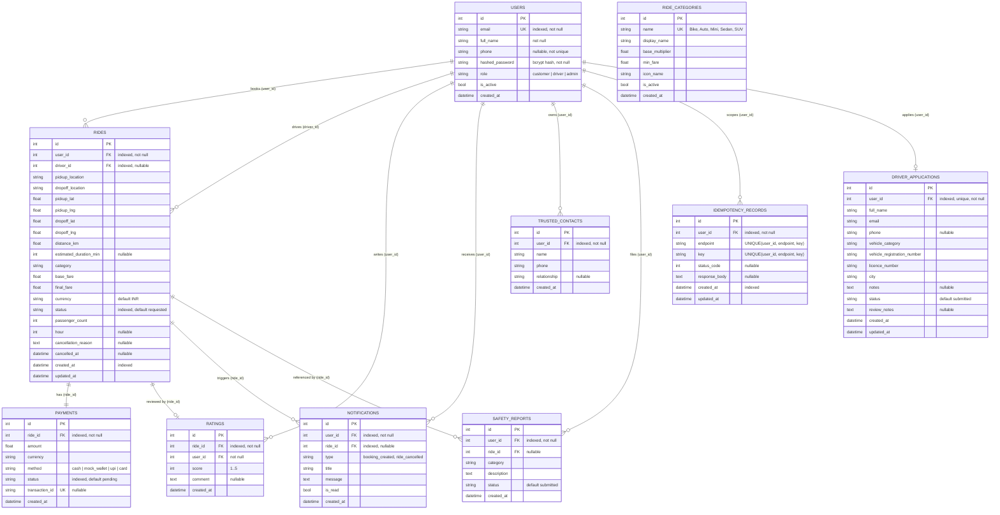

# Database Design

**RideSetGo** — Amritsar ride-hailing platform with ML fare prediction.

This document describes the SQLAlchemy models in `backend/app/models.py` and
the schema they produce. Every table, column, key and constraint listed here
was read from the source and confirmed against the live SQLite database.

**Engine:** SQLite 3 via SQLAlchemy 2.x
**Default URL:** `sqlite:///./ridesetgo.db` (relative to the working directory)
**Migrations:** Alembic, 4 revisions, head `c4e1a7b93d21`
**Tables:** 10 application tables, plus `alembic_version`

---

## 1. Entity-relationship diagram



---

## 2. Relationship details

`USERS` appears twice in relation to `RIDES`, so the two foreign keys are
disambiguated with explicit `foreign_keys` arguments on both sides:

```python
user   = rel("User", foreign_keys="Ride.user_id",      back_populates="rides")
driver = rel("User", foreign_keys="Ride.driver_id")
```

### Verified relationships

| From | To | Cardinality | Mechanism | Notes |
|---|---|---|---|---|
| `users` | `rides` | 1 → many | FK `rides.user_id` → `users.id` | The passenger who booked the ride |
| `users` | `rides` | 1 → 0..many | FK `rides.driver_id` → `users.id` | The assigned driver; nullable until accepted |
| `rides` | `payments` | 1 → 0..1 | FK `payments.ride_id` → `rides.id` | Enforced in the ORM via `uselist=False`; **no unique constraint on `payments.ride_id`** |
| `rides` | `ratings` | 1 → 0..1 | FK `ratings.ride_id` → `rides.id` | ORM `uselist=False`; uniqueness is enforced **in application code**, not by the database |
| `rides` | `notifications` | 1 → many | FK `notifications.ride_id` → `rides.id` | `cascade="all, delete-orphan"` |
| `rides` | `safety_reports` | 1 → many | FK `safety_reports.ride_id` → `rides.id` | Optional link to the trip |
| `users` | `ratings` | 1 → many | FK `ratings.user_id` → `users.id` | The reviewer |
| `users` | `notifications` | 1 → many | FK `notifications.user_id` → `users.id` | The recipient |
| `users` | `trusted_contacts` | 1 → many | FK `trusted_contacts.user_id` → `users.id` | — |
| `users` | `safety_reports` | 1 → many | FK `safety_reports.user_id` → `users.id` | — |
| `users` | `idempotency_records` | 1 → many | FK `idempotency_records.user_id` → `users.id` | Scopes the idempotency key |
| `users` | `driver_applications` | 1 → 0..1 | FK `driver_applications.user_id` → `users.id` | **Unique** — one application per user |

### Relationships enforced by application logic, not by the database

These are real rules in the code, but the database does not enforce them. They
are listed here so that nobody assumes a constraint exists.

| Rule | Enforced in | How |
|---|---|---|
| A ride has at most one payment | `app/api/rides.py` | The booking handler always creates exactly one payment; `get_payment` returns the first match |
| A ride has at most one rating | `app/api/rides.py` → `add_rating` | `db.query(Rating).filter(Rating.ride_id == ride_id).first()` → HTTP 400 if a row already exists |
| A rating's `user_id` must be the ride owner | `app/api/rides.py` → `add_rating` | `ride.user_id != current_user.id` → HTTP 403 |
| A rating is only allowed on a `completed` ride | `app/api/rides.py` → `add_rating` | `ride.status != "completed"` → HTTP 400 |
| A phone number is unique across users | `app/api/auth.py` → `signup` | A duplicate-phone check before insert → HTTP 400. **The `users.phone` column itself is not unique** |
| A driver may hold only one active ride | `app/api/rides.py` → `accept_ride` | Query for a ride in `accepted`/`started` → HTTP 409 |
| `role` is one of `customer` / `driver` / `admin` | `app/api/*` | Checked at each gate. **The column is a plain `String(20)`, not an enum** |

---

## 3. Data dictionary

### `users`

The single identity table for all three roles.

| Column | Type | Null | Default | Index / Constraint | Notes |
|---|---|---|---|---|---|
| `id` | Integer | No | auto | PK, indexed | Surrogate key |
| `email` | String(255) | No | — | **UNIQUE**, indexed | Login identifier; validated as `EmailStr` |
| `full_name` | String(255) | No | — | — | Display name, also used for the driver card on the tracking screen |
| `phone` | String(20) | Yes | `NULL` | — | Checked for uniqueness in the signup handler only |
| `hashed_password` | String(255) | No | — | — | bcrypt hash. The plaintext is never stored or logged |
| `role` | String(20) | Yes | `customer` | — | `customer` \| `driver` \| `admin`. Plain string, not an enum |
| `is_active` | Boolean | Yes | `true` | — | A deactivated account cannot log in (HTTP 401) |
| `created_at` | DateTime(tz) | Yes | `func.now()` | — | Server default |

### `rides`

The central table.

| Column | Type | Null | Default | Index | Notes |
|---|---|---|---|---|---|
| `id` | Integer | No | auto | PK, indexed | Also the source of the booking reference `RSG-{id:06d}` |
| `user_id` | Integer | No | — | **indexed**, FK → `users.id` | The passenger who booked it |
| `driver_id` | Integer | Yes | `NULL` | **indexed**, FK → `users.id` | Set when a driver accepts |
| `pickup_location` | String(255) | No | — | — | Human-readable place name |
| `dropoff_location` | String(255) | No | — | — | Human-readable place name |
| `pickup_lat` / `pickup_lng` | Float | No | — | — | Real coordinates |
| `dropoff_lat` / `dropoff_lng` | Float | No | — | — | Real coordinates |
| `distance_km` | Float | No | — | — | Haversine distance between the two coordinate pairs |
| `estimated_duration_min` | Integer | Yes | `NULL` | — | **Always `NULL` in practice** — the booking handler never sets it, so the tracking screen correctly reports `eta_available: false` |
| `category` | String(50) | No | — | — | `Bike` \| `Auto` \| `Mini` \| `Sedan` \| `SUV`. Plain string, not an FK to `ride_categories` |
| `base_fare` | Float | No | — | — | `distance_km * 15.0` at booking time |
| `final_fare` | Float | No | — | — | `distance_km * 15.0` at booking time — see [Fare note](#fare-note) |
| `currency` | String(3) | No | `INR` | — | — |
| `status` | String(30) | No | `requested` | **indexed** | See [Status fields](#status-fields) |
| `passenger_count` | Integer | No | `1` | — | 1–6, validated by the request schema |
| `hour` | Integer | Yes | `NULL` | — | Request hour 0–23, used as an ML feature |
| `cancellation_reason` | Text | Yes | `NULL` | — | Free text supplied by the customer |
| `cancelled_at` | DateTime(tz) | Yes | `NULL` | — | Set on cancellation |
| `created_at` | DateTime(tz) | No | `func.now()` | **indexed** | — |
| `updated_at` | DateTime(tz) | Yes | — | — | `onupdate=func.now()` |

### `payments`

| Column | Type | Null | Default | Index / Constraint | Notes |
|---|---|---|---|---|---|
| `id` | Integer | No | auto | PK, indexed | — |
| `ride_id` | Integer | No | — | **indexed**, FK → `rides.id` | No unique constraint — one payment per ride is application-enforced |
| `amount` | Float | No | — | — | Copied from `rides.final_fare` at booking time |
| `currency` | String(3) | No | `INR` | — | — |
| `method` | String(50) | No | — | — | `cash` \| `mock_wallet` \| `upi` \| `card`. In practice only `cash` and `mock_wallet` are produced |
| `status` | String(30) | No | `pending` | **indexed** | See [Status fields](#status-fields) |
| `transaction_id` | String(255) | Yes | `NULL` | **UNIQUE** | `MOCK-{ride_id}` for demo online payments; `NULL` for cash |
| `created_at` | DateTime(tz) | No | `func.now()` | — | — |

### `ratings`

| Column | Type | Null | Default | Index / Constraint |
|---|---|---|---|---|
| `id` | Integer | No | auto | PK, indexed |
| `ride_id` | Integer | No | — | **indexed**, FK → `rides.id` |
| `user_id` | Integer | No | — | FK → `users.id` |
| `score` | Integer | No | — | — |
| `comment` | Text | Yes | `NULL` | — |
| `created_at` | DateTime(tz) | No | `func.now()` | — |

`score` is constrained to 1–5 by the Pydantic request schema
(`Field(ge=1, le=5)`), not by a database check constraint.

### `notifications`

| Column | Type | Null | Default | Index / Constraint | Notes |
|---|---|---|---|---|---|
| `id` | Integer | No | auto | PK, indexed | — |
| `user_id` | Integer | No | — | **indexed**, FK → `users.id` | The recipient |
| `ride_id` | Integer | Yes | `NULL` | **indexed**, FK → `rides.id` | Optional link to the trip |
| `type` | String(50) | No | — | — | `booking_created`, `ride_cancelled` |
| `title` | String(255) | No | — | — | — |
| `message` | Text | No | — | — | — |
| `is_read` | Boolean | No | `false` | — | Flipped by `PATCH /notifications/{id}/read` |
| `created_at` | DateTime(tz) | No | `func.now()` | — | — |

### `trusted_contacts`

| Column | Type | Null | Default | Index / Constraint |
|---|---|---|---|---|
| `id` | Integer | No | auto | PK, indexed |
| `user_id` | Integer | No | — | **indexed**, FK → `users.id` |
| `name` | String(255) | No | — | — |
| `phone` | String(30) | No | — | — |
| `relationship` | String(50) | Yes | `NULL` | — |
| `created_at` | DateTime(tz) | No | `func.now()` | — |

### `safety_reports`

| Column | Type | Null | Default | Index / Constraint |
|---|---|---|---|---|
| `id` | Integer | No | auto | PK, indexed |
| `user_id` | Integer | No | — | **indexed**, FK → `users.id` |
| `ride_id` | Integer | Yes | `NULL` | FK → `rides.id` |
| `category` | String(50) | No | — | — |
| `description` | Text | No | — | — |
| `status` | String(30) | No | `submitted` | — |
| `created_at` | DateTime(tz) | No | `func.now()` | — |

### `idempotency_records`

Backs the `Idempotency-Key` header on `POST /rides/book`.

| Column | Type | Null | Default | Index / Constraint |
|---|---|---|---|---|
| `id` | Integer | No | auto | PK, indexed |
| `user_id` | Integer | No | — | **indexed**, FK → `users.id` |
| `endpoint` | String(64) | No | — | — |
| `key` | String(128) | No | — | — |
| `status_code` | Integer | Yes | `NULL` | — |
| `response_body` | Text | Yes | `NULL` | — |
| `created_at` | DateTime(tz) | No | `func.now()` | **indexed** |
| `updated_at` | DateTime(tz) | Yes | — | — |

**The uniqueness guarantee is in the database.** There is a
`UniqueConstraint("user_id", "endpoint", "key", name="uq_idempotency_user_endpoint_key")`
on the table, created by the `c4e1a7b93d21` migration. A second concurrent
request therefore cannot claim the same key — the insert fails at the database
level rather than relying on the application to notice. The application-level
check in `app/core/idempotency.py` is the fast path; the constraint is the
backstop.

### `ride_categories`

| Column | Type | Null | Default | Index / Constraint | Notes |
|---|---|---|---|---|---|
| `id` | Integer | No | auto | PK, indexed | — |
| `name` | String(50) | No | — | **UNIQUE** | `Bike` \| `Auto` \| `Mini` \| `Sedan` \| `SUV` |
| `display_name` | String(100) | No | — | — | e.g. `Auto Rickshaw` |
| `base_multiplier` | Float | No | `1.0` | — | Seeded to match the live category list |
| `min_fare` | Float | No | `40.0` | — | Minimum fare floor |
| `icon_name` | String(50) | Yes | `NULL` | — | `bike`, `auto`, `car` |
| `is_active` | Boolean | No | `true` | — | — |
| `created_at` | DateTime(tz) | No | `func.now()` | — | — |

**Important:** the live `GET /categories/` endpoint is served from
`CATEGORY_CONFIG` in `app/ml/predictor.py` — a hard-coded Python list — **not**
from this table. The table is seeded to mirror that list, but the two are not
linked, and a change to one does not change the other.

### `driver_applications`

| Column | Type | Null | Default | Index / Constraint |
|---|---|---|---|---|
| `id` | Integer | No | auto | PK, indexed |
| `user_id` | Integer | No | — | **indexed, UNIQUE**, FK → `users.id` |
| `full_name` | String(255) | No | — | — |
| `email` | String(255) | No | — | — |
| `phone` | String(30) | Yes | `NULL` | — |
| `vehicle_category` | String(50) | No | — | — |
| `vehicle_registration_number` | String(50) | No | — | — |
| `licence_number` | String(100) | No | — | — |
| `city` | String(100) | No | — | — |
| `notes` | Text | Yes | `NULL` | — |
| `status` | String(30) | No | `submitted` | — |
| `review_notes` | Text | Yes | `NULL` | — |
| `created_at` | DateTime(tz) | No | `func.now()` | — |
| `updated_at` | DateTime(tz) | Yes | — | — |

**This table is currently unreachable from the API.** The model and schema
exist, `list_driver_applications` is defined in `app/api/admin.py` but has no
route decorator, and the frontend service that would call it is not used by
any screen.

---

## 4. Status fields

All status columns are plain `String` columns. There are **no database enum or
check constraints** — the allowed values are enforced in the application code.

### `rides.status`

| Value | Meaning | Set by |
|---|---|---|
| `requested` | Booked, waiting for a driver | `POST /rides/book` |
| `accepted` | A driver has taken the ride | `POST /rides/{id}/accept` |
| `started` | The trip is under way | `PATCH /rides/{id}/status` |
| `completed` | The trip finished | `PATCH /rides/{id}/status` |
| `cancelled` | The customer cancelled | `POST /rides/{id}/cancel` |

The set is defined once in `app/api/rides.py` as `RIDE_STATUS_LABELS` and
`RIDE_PROGRESS_STAGES`, and the same list is accepted by
`PATCH /rides/{id}/status` (anything else → HTTP 400).

### `payments.status`

| Value | Meaning | How it is reached |
|---|---|---|
| `not_applicable` | Cash, paid directly to the driver — not a platform transaction | Set at booking when `payment_method = cash` |
| `pending` | A demo online payment awaiting a gateway | Set at booking for online bookings |
| `completed` | Confirmed by a verified provider webhook | **Not reachable** — no gateway is configured, and the customer-facing endpoint refuses this transition with HTTP 403 |
| `failed` | Declined by the provider | **Not reachable** — same reason |
| `refunded` | Refunded by an administrator | Reachable only by an admin, and only from `pending` |

### `users.role`

`customer` · `driver` · `admin`

### `safety_reports.status` / `driver_applications.status`

Both default to `submitted`. No code path currently changes them.

---

## 5. Indexes and constraints

### Indexes declared in the models (the intended schema)

| Table | Index | Columns | Unique |
|---|---|---|---|
| `users` | `ix_users_email` | `email` | **Yes** |
| `users` | `ix_users_id` | `id` | No |
| `ride_categories` | `ix_ride_categories_id` | `id` | No |
| `rides` | `ix_rides_id` | `id` | No |
| `rides` | `ix_rides_status` | `status` | No |
| `rides` | `ix_rides_created_at` | `created_at` | No |
| `rides` | `ix_rides_user_id` | `user_id` | No |
| `rides` | `ix_rides_driver_id` | `driver_id` | No |
| `payments` | `ix_payments_id` | `id` | No |
| `payments` | `ix_payments_status` | `status` | No |
| `payments` | `ix_payments_ride_id` | `ride_id` | No |
| `ratings` | `ix_ratings_id` | `id` | No |
| `ratings` | `ix_ratings_ride_id` | `ride_id` | No |
| `ratings` | `ix_ratings_user_id` | `user_id` | No |
| `notifications` | `ix_notifications_id` | `id` | No |
| `notifications` | `ix_notifications_user_id` | `user_id` | No |
| `notifications` | `ix_notifications_ride_id` | `ride_id` | No |
| `trusted_contacts` | `ix_trusted_contacts_id` | `id` | No |
| `trusted_contacts` | `ix_trusted_contacts_user_id` | `user_id` | No |
| `safety_reports` | `ix_safety_reports_id` | `id` | No |
| `safety_reports` | `ix_safety_reports_user_id` | `user_id` | No |
| `idempotency_records` | `ix_idempotency_records_id` | `id` | No |
| `idempotency_records` | `ix_idempotency_records_user_id` | `user_id` | No |
| `idempotency_records` | `ix_idempotency_records_created_at` | `created_at` | No |
| `driver_applications` | `ix_driver_applications_id` | `id` | No |
| `driver_applications` | `ix_driver_applications_user_id` | `user_id` | **Yes** |

### Unique constraints

| Table | Scope | How it is expressed |
|---|---|---|
| `users` | `email` | Unique **index** `ix_users_email` (`unique=True, index=True`) |
| `ride_categories` | `name` | Table-level `UNIQUE (name)` |
| `payments` | `transaction_id` | Table-level `UNIQUE (transaction_id)`, nullable |
| `driver_applications` | `user_id` | Unique **index** `ix_driver_applications_user_id` (`unique=True, index=True`) |
| `idempotency_records` | `user_id` + `endpoint` + `key` | Table-level `UNIQUE (user_id, endpoint, key)`, named `uq_idempotency_user_endpoint_key` |

There are **no check constraints** anywhere in the schema, and no other
composite unique constraints.

### Schema drift between the models and an existing database

`Base.metadata.create_all()` only creates tables and indexes that **do not
already exist**. It never adds a column or an index to an existing table. The
checked-in `backend/ridesetgo.db` was created before the current models were
written, so these model-declared indexes are **declared in code but missing
from that file**:

```
ix_rides_status          ix_rides_created_at      ix_rides_user_id
ix_rides_driver_id       ix_payments_status       ix_payments_ride_id
ix_ratings_ride_id       ix_ratings_user_id
```

The `idempotency_records` table **is** covered by the migration chain
(`c4e1a7b93d21`), so `alembic upgrade head` on a clean database produces the
complete current schema for that table.

**Practical effect:** on a database created *before* these changes, queries
that filter by `rides.status` or join on `payments.ride_id` run without a
supporting index. On the small demonstration dataset this is irrelevant, but
it is a real difference between the code and the shipped file. Regenerating
the database with `alembic upgrade head` from a clean state removes the drift
for `idempotency_records`; the remaining index gaps would need one more
migration.

---

## 6. Migrations

```bash
cd backend
alembic current        # current revision
alembic history        # full chain
alembic upgrade head   # apply everything
```

### Chain

| Revision | Down revision | Description |
|---|---|---|
| `6afbbc46177c` | `None` | Add `relationship` column to `trusted_contacts` |
| `89f7ab2b06a1` | `6afbbc46177c` | Add `user_id` column to `ratings` |
| `1d67a3ef848e` | `89f7ab2b06a1` | Add cancellation fields and payment status |
| `c4e1a7b93d21` | `1d67a3ef848e` | Add the `idempotency_records` table, its indexes and the `uq_idempotency_user_endpoint_key` unique constraint (head) |

**Verified:** `alembic upgrade head` on a clean database completes without
error and produces the `idempotency_records` table with the named unique
constraint.

**Remaining gap worth noting.** The chain still predates the indexes added to
`rides`, `payments` and `ratings`. Because `app/main.py` calls
`Base.metadata.create_all()` at import time, a fresh database gets the
current schema regardless. But a database migrated with `alembic upgrade head`
and **not** started through the application would be missing those indexes.
The clean fix is one more migration for the current model state, and making
`alembic upgrade head` the only supported initialisation path.

---

## 7. Fare note

`POST /rides/book` stores:

```python
base_fare  = ride_in.distance_km * 15.0
final_fare = ride_in.distance_km * 15.0
```

This is a flat demo formula, **not** the ML estimate produced by
`POST /fare/estimate`, and it does not apply the category multiplier. The
frontend sends the `distance_km` it obtained from the estimate endpoint, so
the two figures are derived from the same distance but by different rules. A
booked fare can therefore differ from the estimate the customer agreed to.
This is a genuine inconsistency in the current implementation and is listed in
[`docs/FEATURE_STATUS.md`](FEATURE_STATUS.md).

---

## 8. Which database am I looking at?

`DATABASE_URL` defaults to `sqlite:///./ridesetgo.db`, and SQLite resolves a
relative path against the **current working directory**. The repository
contains two files:

| File | Contents | Created when |
|---|---|---|
| `backend/ridesetgo.db` | `alembic_version` + 10 tables, and the rows produced by the demo accounts and the smoke test | Running the server from `backend/` |
| `ridesetgo.db` (repository root) | 10 tables, **0 rows** | Running the server from the repository root |

At the time of writing, `backend/ridesetgo.db` held 41 users, 13 rides,
13 payments, 1 rating, 6 notifications, 2 trusted contacts, 1 safety report,
5 ride categories and 0 driver applications. These counts grow every time
`scripts/smoke_test.py` runs, so treat them as an indication of scale rather
than a fixed figure.

Always set `DATABASE_URL` explicitly, or always launch the server from the
same directory, so you are certain which database you are demonstrating.
