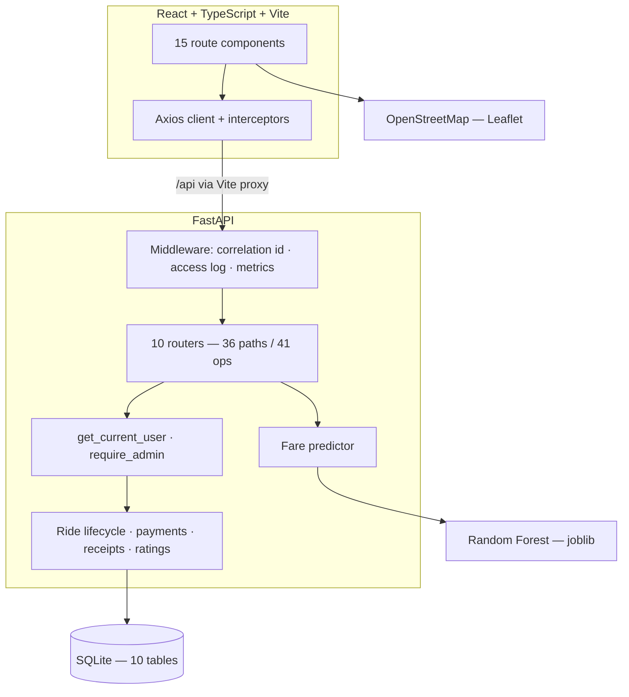
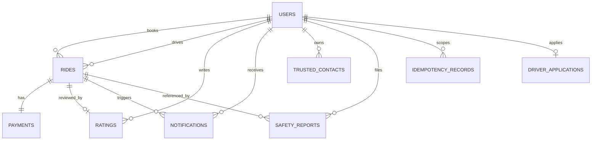
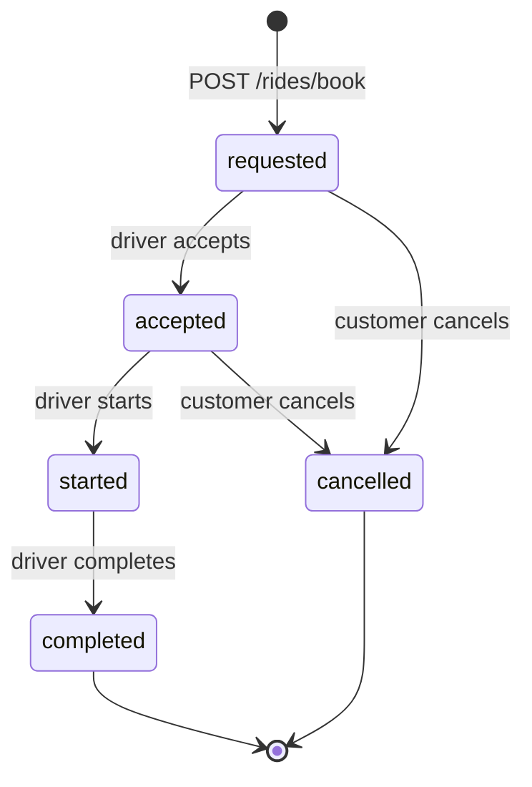
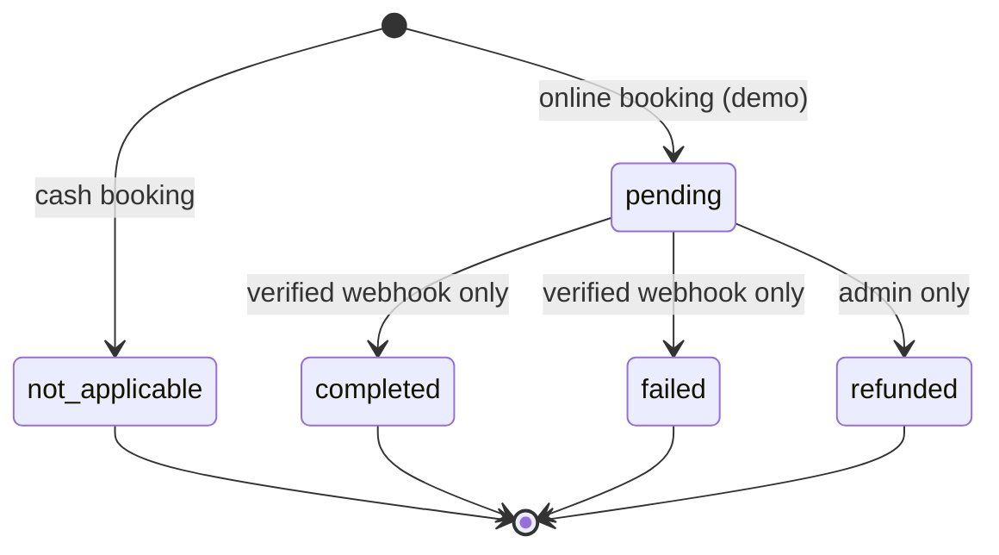

# Presentation Outline

**RideSetGo — Amritsar Ride-Hailing Platform with ML Fare Prediction**

Target length: **12–15 minutes** (12 slides plus a demonstration). Each slide
gives the content, the visual, and the sentence to say. Slides marked
**[DEMO]** are where you switch to the running application.

> **Rule for this deck.** Every number in it was read from the source or from
> a command that was actually run. There are no invented statistics. Where a
> figure would normally appear and no measurement supports it, the slide says
> so — that is a strength in a viva, not a weakness.

---

## Slide 1 — Title

**RideSetGo**
Amritsar Ride-Hailing Platform with Machine-Learning Fare Prediction

*Final-year project demonstration*
Team / Roll numbers / Guide / Date

**Visual:** the landing page hero (`docs/screenshots/01-landing-page.png`).

**Say:** *"RideSetGo is a ride-hailing application for Amritsar whose core is a
fare estimator trained on 49,310 real Amritsar trip records. I'll show you
the architecture, the design decisions, and then run the application."*

---

## Slide 2 — Problem statement

**The problem**

- Riders in Amritsar get a verbally quoted fare with **no way to check it**.
- Fares are not derived from published data, so a quote cannot be justified.
- A trip exists as a phone call and a cash handover — **no auditable record**.

**What we set out to build**

1. A **transparent, data-derived fare estimate** before booking.
2. A **role-separated, auditable ride record** from booking to completion.
3. An **operational view** for an administrator.

**Visual:** three cards, one per point.

**Say:** *"The gap is price opacity and the absence of a shared record. It is
not that ride-hailing is missing in Amritsar — it is that the fare function
for local routes is not published and not learnable."*

---

## Slide 3 — Objectives

| # | Objective | Status |
|---|---|---|
| 1 | Predict fares from real trip data | **Done** — R² 0.9968 |
| 2 | Per-category fares for 5 vehicle types | **Done** |
| 3 | Secure auth + 3-role authorisation | **Done** |
| 4 | Full ride lifecycle | **Done** |
| 5 | History, receipts, ratings, notifications | **Done** |
| 6 | Admin dashboard over live data | **Done** |
| 7 | Observability (logs, metrics, health) | **Done** |
| 8 | Live GPS tracking | **Partial** — status timeline only |
| 9 | Real payments | **Not done** — see slide 11 |
| 10 | Deployment and performance testing | **Not done** — see slide 12 |

**Visual:** a two-column table; the honest rows in amber, not hidden.

**Say:** *"I'm showing the incomplete items on this slide deliberately rather
than leaving them off. Slide 12 covers exactly what is missing."*

---

## Slide 4 — System architecture



**Visual:** the diagram above, rendered from `docs/ARCHITECTURE.md`.

**Say:** *"Three tiers. The browser never talks to the database or the model.
Every request crosses one middleware that assigns a correlation id, writes the
access log and updates the metrics, then hits a router, then a dependency
that resolves the caller's identity, then the business logic. The client
calls one relative URL — `/api/...` — and the same path works in development
and production."*

---

## Slide 5 — Technology stack

| Layer | Choice | Why this one |
|---|---|---|
| Frontend | **React + TypeScript + Vite** | TS types mirror the Pydantic schemas, so a server change becomes a client compile error. `tsc` gates the build |
| API | **FastAPI** | Auto-generated OpenAPI — the entire API reference is machine-written, not hand-maintained |
| ORM | **SQLAlchemy 2.x + Alembic** | Explicit relationships, migrations generated from the models |
| Database | **SQLite** | Zero-infrastructure; `DATABASE_URL` is a config change to PostgreSQL |
| Auth | **bcrypt + JWT (HS256)** | bcrypt is deliberately slow — that is the point |
| Model | **scikit-learn Random Forest** | Handles mixed feature types without scaling; feature importances for explainability |
| Maps | **Leaflet + OpenStreetMap** | Real tiles with **no API key** — one fewer credential in the demo |
| State | **Zustand** | One persisted store; the Axios interceptor reads the token from it |

**Visual:** a clean table. Do not list versions here — save them for a
question.

---

## Slide 6 — The fare estimator (core module)

**Data:** 49,310 real Amritsar trips × 21 columns, 37 locations with real coordinates.

**Features (5):** `pickup_code`, `dropoff_code`, `distance_km`, `passenger_count`, `hour`

**Model:** `RandomForestRegressor(n_estimators=100, random_state=42)`

| MAE | RMSE | R² |
|---|---|---|
| **₹7.33** | **₹9.19** | **0.9968** |

**Pipeline:** validate → resolve coordinates → haversine distance → encode →
predict → per-category fare.

**Visual:** the pipeline diagram from `docs/ARCHITECTURE.md` §3.

**Say — include this, do not skip it:**

> "Two honest caveats. First, the R² is agreement with the *historical
> dataset* — it is not accuracy against live Uber pricing. Second, the five
> category fares are heuristic multipliers on one base fare, not five trained
> models. The code says so, and the API returns the same statement to the
> client."

**The best point to make:** *"The training script and the inference pipeline
compute distance with the same haversine function over the same real
coordinates. That is deliberate — train/serve skew on the distance feature
is the classic way a fare model silently breaks in production."*

---

## Slide 7 — Database design



**Design decisions**

- **One `users` table for all three roles** — one identity, one token, one
  authorisation path.
- **`rides` has two FKs to `users`** — the passenger and the driver.
- **Status is a string, not an enum** — the allowed values live in the API
  layer, defined once.
- **Indexes on every foreign key** and on every filtered column.
- **Alembic** for versioned migrations; 4 revisions, at head.

**Say:** *"One payment per ride and one rating per ride are enforced in the
application, not by a unique constraint. That is a real gap, and it is listed
in the report."*

---

## Slide 8 — Security and role-based access control

| Concern | Implementation |
|---|---|
| Password | bcrypt, salted, adaptive |
| Session | Signed JWT (HS256), 7-day expiry, restored only after server confirmation |
| **Authentication** | *Who are you?* → `get_current_user` |
| **Authorisation** | *What may you do?* → `require_admin` + inline role and ownership checks |
| Payment | A client can **never** set a payment outcome — 403 |
| Errors | No stack trace, SQL or connection string ever reaches a client |
| Privacy | Client IP logging off by default; the error reporter has no field for identity |

**Verified negative cases:** passenger → admin API = **403**; passenger →
driver queue = **403**; other passenger → your receipt = **403**; customer
marks own payment paid = **403**.

**Say:** *"Authentication and authorisation are different questions and the
code answers them separately. The 403 on the admin API is enforced on the
server — hiding a button is not security."*

---

## Slide 9 — Core modules

| Module | Screens | Endpoints |
|---|---|---|
| Passenger | Home, Ride options, Trip details, History, Receipt, Tracking, Profile | `/fare/estimate`, `/rides/*` |
| Driver | Driver dashboard — queue, accept, start, complete | `/rides/available`, `/rides/{id}/accept` |
| Admin | Operations dashboard — stats, rides, payments, users, system health | `/admin/*` |
| Safety | Trusted contacts, incident reports | `/safety/*` |
| Platform | Health, metrics, structured logging | `/health/*`, `/admin/system-health` |

**Visual:** three columns, Passenger / Driver / Admin, each with a small
screenshot.

**Say:** *"The admin dashboard has no seeded or sample data. Every figure is
a SQL aggregation over the live database. The revenue tile reads zero — and
that is correct, because no payment can complete without a gateway. I'll come
back to that."*

---

## Slide 10 — Observability

- **Structured logging** — text or JSON, one record per request.
- **Correlation ids** — `X-Request-ID` on every request and response; the
  same id is in the log, so a user can quote a reference that maps to one
  log line.
- **Metrics** — request counters, status-class breakdown, latency
  percentiles, database readiness.
- **Three probes with distinct meanings** — `/health/live` never touches the
  database (a failing liveness probe would restart a healthy process);
  `/health/ready` checks the database and returns 503 so a load balancer
  stops sending traffic.
- **Sanitised errors** — the traceback goes to the log, the client gets a
  generic body.
- **Idempotency** — an `Idempotency-Key` on booking means a retry after a
  timeout cannot create a second ride and a second payment.

**Say:** *"The health endpoint contract is the part I'd point an examiner to:
liveness and readiness are genuinely different questions, and this system
answers them differently."*

---

## Slide 11 — What is honestly *not* implemented

| Not implemented | Why, and what exists instead |
|---|---|
| **Real payments** | No gateway configured; the webhook does not verify signatures. The client **cannot** mark its own payment paid — 403. Correct behaviour, but it means revenue is ₹0 |
| **Live GPS tracking** | No GPS stored, no routing provider. The API returns `live_tracking_available: false` and null `driver_location` / `route_geometry`, and the screen says so |
| **Auto driver dispatch** | A driver accepts by hand. No proximity search |
| **Email / SMS / push** | Notifications are in-app rows only, and there is no bell in the UI yet |
| **Driver applications** | The table and model exist, but no route serves them. Dead code — and I removed nothing, so it's visible |
| **Scheduled rides** | The control is labelled "Coming Soon" |
| **Rating aggregation** | Ratings are stored; there is no average-per-driver endpoint |
| **Deployment** | No Dockerfile, no CI, no verified deployment |
| **Performance testing** | **No load suite exists, so I have no throughput or latency-under-load figures to quote** |

**Say — this is the slide that wins the viva:**

> "I want to be precise about the boundary. The tracking endpoint doesn't
> return a fake moving marker — it returns `live_tracking_available: false`.
> The payment endpoint doesn't let the browser declare success — it returns
> 403. Those are the same design decision, and it runs through the whole
> system: never present an estimate as a fact, never present an absent
> capability as present."

---

## Slide 12 — Testing: actual results

```
Backend tests       79 passed, 0 failed          (83.72s)
End-to-end checks   83 passed, 0 failed          (live server, over HTTP)
Production build    ✓ 1706 modules, built in 25.10s
```

**What is covered:** authentication · fare estimation and its validation
errors · booking · the ride lifecycle · cancellation rules · the payment
state machine · receipts · ratings · notifications · ownership isolation ·
role-based access control · health probes · idempotent booking.

**A real bug the end-to-end layer caught:**

> `GET /rides/available` returned **422** instead of 200, because it was
> declared after `GET /rides/{ride_id}` and FastAPI matched the path
> parameter first. The driver dashboard's request queue was broken. I found
> it in the final audit, moved the route, documented the ordering constraint
> in the handler, and added a regression check. The unit-level tests did not
> cover the route table — only a real request against a running server
> exposed it.

**Not tested — stated plainly:** no unit tests for the models in isolation ·
no browser-level regression suite · **no load, stress or concurrency tests** ·
no coverage report.

---

## Slide 13 — Live demonstration

**[DEMO — 8 minutes]**

1. Landing page
2. Passenger sign-up and login
3. **Fare estimate** — Golden Temple → Amritsar Airport
4. **Book a ride**
5. **Driver workflow** in a second browser — accept, start, complete
6. **Trip tracking** — and read out the honest capability notice
7. **Receipt** — booking reference, fare breakdown, demo disclaimer
8. **Rating** on the completed ride
9. **Admin dashboard** — stats, filters, system health
10. **Access control** — Swagger UI, 403s and 400s on screen

The full script, with timings and speaker notes, is in
[`docs/DEMO.md`](DEMO.md).

---

## Slide 14 — Limitations and future work

**Limitations (full list in the report, Chapter 15)**

- No payment processing · no GPS · no auto-dispatch · no push notifications
- SQLite only · metrics are in-process · the model artifact is 300 MB
- `SECRET_KEY` has a placeholder default · the token is in `localStorage` ·
  no rate limiting on login
- The booked fare uses a flat formula, not the ML estimate
- Four dead frontend API calls and one unreachable backend function

**Future work — ordered by value per unit of effort**

| Priority | Item |
|---|---|
| 1 | Use the ML estimate for the booked fare (removes a real inconsistency) |
| 2 | A k6/Locust load suite — **this is what turns the manual demo into a measurable claim** |
| 3 | A Playwright regression suite over the demo flow |
| 4 | Rate limiting on `/auth/login` — closes the highest-severity weakness |
| 5 | A real payment gateway with webhook signature verification |
| 6 | Driver GPS + ETA — the API contract is already designed for it |
| 7 | PostgreSQL, a shared metrics store, Docker and CI |

**Say:** *"The top item isn't a new feature. It's the load test suite and the
browser regression suite — because the metrics infrastructure to support them
already exists, and because they would turn a set of manual steps into a
repeatable, measurable claim."*

---

## Slide 15 — Conclusion

- A working full-stack ride-hailing application for Amritsar, built around a
  fare estimator trained on **49,310 real trips** (MAE **₹7.33**, R²
  **0.9968**).
- **36 API paths / 41 operations**, 10 database tables, 15 frontend screens.
- Three roles, with authorisation enforced **on the server**.
- **79 backend tests + 83 end-to-end checks + a clean production build — all
  passing.**
- The design rule that runs through it: **never present an estimate as a
  fact, never present an absent capability as present, and never let a client
  decide the outcome of a payment.**
- The limits are documented, not hidden — and the next step is measurement,
  not features.

**Thank you. Questions?**

---

## Appendix — Backup slides

Keep these ready for questions; do not present them unless asked.

### A1 — The ride lifecycle



### A2 — The payment state machine



### A3 — How idempotency works

`Idempotency-Key` header → claim `(user_id, "rides.book", key)` → first time:
create the ride, store the response → retry: return the stored response →
still in progress: `409` → failed: release the key so the customer can retry.

### A4 — The full API surface

36 paths / 41 operations / 10 tags: `auth` 4 · `rides` 14 · `fare` 1 ·
`locations` 1 · `categories` 1 · `notifications` 2 · `safety` 6 · `admin` 6 ·
`health` 3 · `diagnostics` 1.

### A5 — Model metrics and their limits

MAE ₹7.33 · RMSE ₹9.19 · R² 0.9968 — on a held-out 20% of 49,310 historical
records. **Not** a comparison against live operator pricing. **Not** a
per-category model. **Not** validated on unseen routes beyond that single
split.

### A6 — The complete verification record

| Command | Result |
|---|---|
| `pytest tests -q` | 79 passed, 41 warnings, 83.72s |
| `python scripts/smoke_test.py` | 83 passed, 0 failed |
| `npm run build` | ✓ 1706 modules, 25.10s |
| `GET /health` | 200, `database: connected` |
| `GET /admin/system-health` | 200, full metrics payload |
