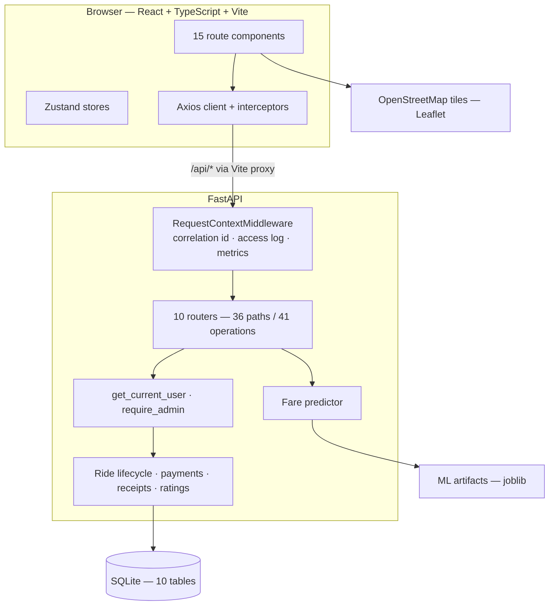
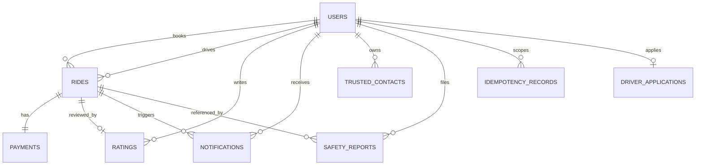

# RideSetGo — Final-Year Project Report

**Amritsar Ride-Hailing Platform with Machine-Learning Fare Prediction**

> **Scope note.** This report describes the system as it is actually
> implemented. Sections that would normally contain performance benchmarks,
> user studies or accuracy comparisons against a commercial operator are
> present but explicitly marked as *not available*, because no such measurement
> was carried out. Nothing in this report is estimated, extrapolated or
> invented. Every figure quoted was read from the source code, the database
> or the output of a command that was actually run.

---

## Chapter 1 — Abstract

RideSetGo is a full-stack web application that provides ride-hailing
functionality for Amritsar, India. Its central contribution is a
**machine-learning fare estimator trained on 49,310 real Amritsar trip
records**, which produces a transparent, explainable fare estimate for any
route between 37 known locations before the customer commits to a booking.

Around that estimator, the system implements a complete ride lifecycle: a
passenger books a ride, a driver accepts it and advances it through
`accepted → started → completed`, an administrator observes the whole
platform in real time, and every party sees only what their role permits. The
application is a REST API built on FastAPI with a React and TypeScript
single-page front end, persisted in SQLite through SQLAlchemy.

The system is explicitly a **demonstration project**. It does not dispatch
real drivers, does not stream GPS positions and does not process real money.
Where a capability is absent, the application reports that absence through
its API contract (`capabilities.live_tracking_available: false`) and in its
user-facing copy, rather than presenting plausible-looking placeholder
behaviour. This is a deliberate design decision, and the reasoning is
discussed in Chapter 12.

The implemented system was verified by 78 automated backend tests, a
production TypeScript build, and an 83-assertion end-to-end script that
exercises the complete walkthrough — including every negative case — against
a live server. All 83 checks pass.

---

## Chapter 2 — Introduction

### 2.1 Context

Ride-hailing is a mature service in metropolitan markets. In Amritsar it is
present but different in character: the operator set is smaller, demand is
concentrated around a handful of landmarks (the Golden Temple, the railway
station, the airport, the bus stand, the border), and the fare is usually
agreed verbally rather than quoted from a published tariff.

This produces two specific problems for the rider:

- **Price opacity.** There is no way to check whether a quoted fare is
  reasonable before agreeing to it, because the underlying relationship
  between distance, time, vehicle type and fare is not published.
- **No shared record.** The trip exists as a phone call and a cash
  handover. Neither the passenger nor the operator has a durable record of
  what was agreed.

### 2.2 What this project does

RideSetGo addresses the first problem with a trained model and the second
with a persisted, role-scoped trip record. It is designed as a demonstration
of how a full-stack, machine-learning-backed application is architected,
secured and tested — and it is explicit about the boundary between what is
implemented and what is not.

### 2.3 Scope of the demonstration

| In scope | Out of scope |
|---|---|
| ML fare estimation from real trip data | Real driver dispatch / auto-matching |
| Customer, driver and administrator accounts with role-scoped access | Driver GPS tracking and ETA |
| Full ride lifecycle with server-enforced state transitions | Real payment processing |
| Trip history, receipts, ratings, notifications | Email / SMS / push delivery |
| Trusted contacts and incident reporting | Emergency dispatch |
| Structured logging, metrics, health probes | Production deployment and scaling |
| Idempotent booking | Load / performance benchmarking |

---

## Chapter 3 — Problem Statement

### 3.1 Statement

> Riders in Amritsar cannot obtain a reliable, explainable fare estimate
> before booking a ride, and operators have no way to justify a quoted fare
> from data. Additionally, rides are not tracked through a single auditable
> record, so neither the passenger nor the operator can verify what was
> agreed after the fact.

### 3.2 Analysis

Breaking this down:

| # | Sub-problem | Consequence |
|---|---|---|
| P1 | No pre-booking fare estimate | The customer cannot compare options or budget |
| P2 | No published relationship between trip attributes and fare | A quoted fare cannot be justified or challenged |
| P3 | No auditable trip record | Disputes cannot be settled; no history exists |
| P4 | No operational visibility | An operator cannot see demand, status distribution or payments |
| P5 | No role separation | A single account type cannot safely serve three different actors |

### 3.3 Requirements derived from the problem

**Functional**

- FR1: The system shall estimate a fare for any route between two known
  locations, and shall do so from a trained model over real data.
- FR2: The system shall support a passenger, a driver and an administrator,
  with each able to perform only their own operations.
- FR3: The system shall record every ride through an auditable status
  lifecycle and expose that history to its owner.
- FR4: The system shall produce a receipt for a stored booking, and shall
  never represent an estimate as an amount charged.
- FR5: The system shall allow a rating only on a completed ride, and only by
  the passenger who booked it.
- FR6: The system shall let an administrator inspect users, rides, payments
  and live system health.

**Non-functional**

- NFR1: A password shall never be stored or logged in plaintext.
- NFR2: A client shall never be able to determine the outcome of a payment.
- NFR3: No stack trace, SQL statement or connection string shall reach a
  client.
- NFR4: The system shall report the absence of a capability rather than
  simulate it.
- NFR5: A repeated booking request shall not create a duplicate ride or
  payment.

---

## Chapter 4 — Objectives and Scope

### 4.1 Objectives

| # | Objective | Achieved | Evidence |
|---|---|---|---|
| O1 | Train a fare model on real Amritsar data | Yes | `ml/train_model.py`; artifacts committed; MAE ₹7.33, RMSE ₹9.19, R² 0.9968 |
| O2 | Serve estimates over a REST API with validation | Yes | `POST /fare/estimate`; 3 rejection paths verified |
| O3 | Implement secure authentication | Yes | bcrypt + JWT; 4 endpoints; wrong-password and no-token paths verified |
| O4 | Implement role-based authorisation | Yes | 3 roles; customer/driver both receive 403 on every admin endpoint |
| O5 | Implement the ride lifecycle with server-enforced transitions | Yes | 5 statuses; 4 distinct rejection rules verified |
| O6 | Implement a driver workflow | Yes | Queue, accept, start, complete; 409 conflict guard verified |
| O7 | Implement an admin dashboard over live data | Yes | 6 admin endpoints; no fabricated figures |
| O8 | Implement history, receipts and ratings | Yes | Receipt and rating verified end to end |
| O9 | Implement trip tracking | Partly | Status timeline complete; GPS, ETA and route geometry not implemented, and reported as unavailable |
| O10 | Implement a working payment flow | No | Receipts complete; no gateway, and no payment can reach `completed` |
| O11 | Implement observability | Yes | Structured logging, correlation ids, metrics, 3 health probes |
| O12 | Implement production deployment | No | No Dockerfile, CI or verified deployment exists |
| O13 | Implement performance testing | No | No load or benchmark suite exists |

### 4.2 Scope statement

The demonstration covers the Amritsar city area, 37 known locations and five
vehicle categories. It runs as a single-instance application backed by SQLite.
The scope deliberately excludes everything that requires a third-party paid
service, a physical device fleet, or a payment merchant relationship.

---

## Chapter 5 — Existing System and Limitations

### 5.1 What exists today in Amritsar

| Method | Strength | Limitation |
|---|---|---|
| Operator app | Large fleets, real-time vehicle location | Limited to metro operations; not deployed at the scale or price point relevant to regional trips |
| Taxi / auto-rickshaw on the street | No booking overhead, immediate availability | No price transparency, no record, no accountability |
| Phone-based local operators | Flexible, local knowledge | Fares are quoted verbally and inconsistently; nothing is auditable; no estimate is available before the trip |
| Aggregator booking sites | Convenience | Route and fare are not modelled on local trip data |

### 5.2 The specific gap

The gap is not that ride-hailing is absent. It is that **for the specific
route-and-time combinations in Amritsar, the fare function is not published
and not learnable from the operator's side**. A rider has no reference point,
and an operator has no evidence base for the quote they give.

### 5.3 What a system like this can and cannot fix

This project addresses the **price opacity and record-keeping** gap. It
explicitly does not address fleet supply, driver income, safety outcomes or
payment regulation, because none of those can be addressed by a software
demonstration.

---

## Chapter 6 — Proposed System

RideSetGo is proposed as a three-tier web application.

**Presentation tier.** A React single-page application with client-side
routing, 15 route components and role-aware navigation. It calls the API
through a single typed Axios client with request and response interceptors
that attach the bearer token and normalise every failure into one predictable
shape.

**Application tier.** A FastAPI service exposing 36 paths / 41 operations
across 10 tags, with Pydantic request validation, SQLAlchemy persistence, a
JWT-based authentication dependency, a role gate for administrator endpoints,
and ownership checks on every per-ride operation.

**Data tier.** Ten SQLAlchemy models over SQLite, with Alembic migrations, a
trained scikit-learn Random Forest served from joblib artifacts, and a
location database of 37 real Amritsar coordinates.

**The distinguishing element** is the estimator, and the design rule that
governs the whole application: *never present an estimate as a fact, and never
present an absent capability as present.* The receipt says it is a demo
estimate. The tracking endpoint returns explicit capability flags. The
payment endpoint refuses to let a client declare its own payment paid. The
admin dashboard reports zero revenue because zero payments have genuinely
completed.

---

## Chapter 7 — Requirements Analysis

### 7.1 Use cases

| ID | Use case | Primary actor | Precondition | Main flow |
|---|---|---|---|---|
| UC1 | Register an account | Visitor | — | Fill form → validate → hash password → create user → issue JWT |
| UC2 | Estimate a fare | Passenger | Logged in (or not) | Pick two locations → validate → resolve coordinates → predict → apply category multiplier |
| UC3 | Book a ride | Passenger | Logged in | Choose category → confirm → create ride + payment + notification |
| UC4 | Accept and progress a ride | Driver | Role = driver | View queue → accept → start → complete |
| UC5 | Track a ride | Passenger, assigned driver, admin | Logged in, authorised | Poll tracking endpoint → render timeline, driver, coordinates |
| UC6 | Cancel a ride | Passenger | Ride is `requested` or `accepted` | Supply reason → set status, reason, timestamp → notify |
| UC7 | Rate a ride | Passenger | Ride is `completed` and unrated | Choose 1–5, optional comment → store |
| UC8 | View receipt | Owner, admin, driver | Ride exists | Fetch ride + payment → render receipt with disclaimer |
| UC9 | Monitor the platform | Admin | Role = admin | Fetch stats, rides, payments, system health |
| UC10 | Report a safety incident | Passenger | Logged in | Describe incident, optionally link own ride → store |

### 7.2 Business rules extracted from the code

These are the actual rules the server enforces, each confirmed by a test.

| ID | Rule | Violation response |
|---|---|---|
| BR1 | Email must be unique | 400 |
| BR2 | Phone must be unique | 400 |
| BR3 | A booking starts in `requested` | — |
| BR4 | A ride can only be accepted while `requested` and unclaimed | 409 |
| BR5 | A driver may hold at most one ride in `accepted`/`started` | 409 |
| BR6 | Only `requested` or `accepted` rides can be cancelled | 400 |
| BR7 | A cancelled ride cannot be cancelled again | 400 |
| BR8 | Only the owner may cancel | 403 |
| BR9 | Only the owner, a driver or an admin may read a ride | 403 |
| BR10 | Only `driver`/`admin` may list or accept rides | 403 |
| BR11 | Only `admin` may read the admin API | 403 |
| BR12 | A rating requires a `completed` ride | 400 |
| BR13 | One rating per ride | 400 |
| BR14 | Only the owner may rate | 403 |
| BR15 | Terminal payment states cannot change | 400 |
| BR16 | A cash payment cannot change at all | 400 |
| BR17 | Only a provider webhook may mark an online payment paid or failed | 403 |
| BR18 | Only an admin may refund | 403 |
| BR19 | A receipt is never produced for a non-existent booking | 404 |
| BR20 | The same `Idempotency-Key` never creates a second ride | replayed response |

### 7.3 Functional requirements

| ID | Requirement | Implementation |
|---|---|---|
| FR1 | Estimate a fare from a trained model | `app/api/fare.py` → `predictor.predict_fare` |
| FR2 | Register, sign in, sign out, view profile | `app/api/auth.py` |
| FR3 | Book a ride | `app/api/rides.py` → `book_ride` |
| FR4 | List ride history | `app/api/rides.py` → `list_my_rides` |
| FR5 | Advance the ride status | `app/api/rides.py` → `update_ride_status` |
| FR6 | List and accept available rides | `app/api/rides.py` |
| FR7 | Cancel with a reason | `app/api/rides.py` → `_cancel_ride_service` |
| FR8 | Read and update the payment record | `app/api/rides.py` |
| FR9 | Produce a receipt | `app/api/rides.py` → `get_receipt` |
| FR10 | Rate a completed ride | `app/api/rides.py` → `add_rating` |
| FR11 | Read the tracking payload | `app/api/rides.py` → `get_ride_tracking` |
| FR12 | List and mark notifications | `app/api/notifications.py` |
| FR13 | Manage trusted contacts | `app/api/safety.py` |
| FR14 | File safety reports | `app/api/safety.py` |
| FR15 | Admin statistics, browsing and system health | `app/api/admin.py` |
| FR16 | Health and liveness probes | `app/api/health.py` |
| FR17 | Optional client error reporting | `app/api/diagnostics.py` |

---

## Chapter 8 — System Architecture

The full architecture, with editable Mermaid source, is in
[`docs/ARCHITECTURE.md`](ARCHITECTURE.md). The summary is:



### 8.1 Key architectural decisions and their rationale

| Decision | Rationale |
|---|---|
| Sync SQLAlchemy sessions with a dependency-injected `get_db` | The whole application is request/response; async would add complexity with no measured benefit at this scale |
| Middleware outermost | The correlation id, access log and metrics must also cover CORS pre-flight requests, which never reach a handler |
| `debug=False` on the FastAPI app | FastAPI's debug mode replaces 500 responses with a full HTML traceback. `DEBUG` in the settings only changes the log level |
| Role as a string column, not an enum | Simplicity for a three-value role set; the values are validated at every gate |
| Payment outcome never accepted from the client | The single most important security rule in the system; a client that can mark its own payment paid makes the whole payment table meaningless |
| Tracking capabilities reported as data | A `capabilities` object makes the absence of GPS a machine-readable fact rather than a UI convention, and lets a real data source be added without changing the contract |
| Idempotency via a header, not by making booking idempotent by nature | A booking is inherently non-idempotent, but a retry after a network timeout must not create a second ride. The key is optional, so existing behaviour is unchanged |
| Metrics in-process | No external dependency for a demonstration. The cost is that they reset on restart and are not shared between workers — this is stated rather than hidden |

### 8.2 Request lifecycle

Every request passes through, in order:

1. `RequestContextMiddleware` — validate or generate `X-Request-ID`, start the
   timer, emit the access log record, update the metrics registry.
2. `CORSMiddleware` — origin check against `ALLOWED_ORIGINS`.
3. Route handler — Pydantic request validation.
4. `get_current_user` dependency — decode the JWT, load the user, 401 on
   failure.
5. Role gate — `require_admin` for `/admin/*`, inline checks elsewhere.
6. Business logic — ownership check, state-machine rules, database access.
7. Response — schema-validated by Pydantic, status recorded by the middleware.

---

## Chapter 9 — Technology Stack

### 9.1 Selection rationale

| Choice | Why |
|---|---|
| **React** | Component composition maps directly onto the feature screens; the team already knew it. React Hook Form handles the form-heavy signup and safety screens cleanly |
| **TypeScript** | The single largest source of correctness in the project. The frontend's `types/index.ts` mirrors the backend's Pydantic schemas, so a schema change on the server surfaces as a compile error on the client. The production build runs `tsc` first, so a type error fails the build |
| **Vite** | Fast dev server with a `/api` proxy that mirrors production routing, and a production build that is TypeScript-aware. The build output shows per-route code splitting — the driver and admin pages are separate chunks that a passenger never downloads |
| **FastAPI** | Native async support, automatic OpenAPI generation (the entire API reference in Chapter 10 is machine-generated, not hand-maintained), Pydantic validation integrated into the request lifecycle, and a clean `Depends` model for the auth and role gates |
| **SQLAlchemy 2.x** | The ORM gives explicit relationships and readable queries without a second query language. The models are the single source of truth for the schema, and Alembic generates migrations from them |
| **SQLite** | Zero-infrastructure, and the dataset fits in memory. `DATABASE_URL` is configurable and the ORM layer is portable, so PostgreSQL is a configuration change rather than a rewrite |
| **Alembic** | Version-controlled, reversible schema changes, with a working revision chain already in the repository |
| **scikit-learn Random Forest** | Handles the mixed feature types (two categorical location codes, three continuous/numeric features) without scaling, resists overfitting on tabular data, and provides feature importances for explainability. 100 trees on 49,310 rows trains in minutes on a laptop |
| **Zustand** | Minimal API for the two pieces of cross-screen state (auth session, current trip). The `persist` middleware restores a session across reloads, and the interceptor reads the token from the same store, so there is one source of truth |
| **bcrypt + python-jose** | bcrypt is deliberately slow, which is the point — it makes offline cracking expensive. python-jose provides a small, well-audited JWT implementation |
| **Leaflet + OpenStreetMap** | Renders real OpenStreetMap tiles with **no API key**, which removes a credential from the demo entirely. React Leaflet gives a declarative React wrapper |

### 9.2 Versions

Verified in the development environment on 19 October 2026:

| Component | Version |
|---|---|
| Python | 3.13.5 |
| Node.js / npm | 24.22.0 / 11.19.1 |
| FastAPI | 0.143.3 (pinned as 0.115.0 in `requirements.txt`) |
| SQLAlchemy | 2.1.5 (pinned as 2.0.36) |
| Pydantic | 2.14.1 (pinned as 2.10.0) |
| scikit-learn | 1.9.1 |
| pandas / numpy | 3.0.6 / 2.5.4 |
| React / TypeScript / Vite | 18.3.1 / 5.6.3 / 5.4.21 |
| Tailwind CSS | 3.4.19 |

**Honest note.** `requirements.txt` pins versions that differ from what is
actually installed. The application runs correctly on the installed versions
and the full test suite passes on them, but the file should be regenerated
from the working environment before anyone else tries to reproduce the build.

---

## Chapter 10 — Database Design

The full data dictionary and ER diagram are in
[`docs/DATABASE.md`](DATABASE.md). Ten tables, all verified against the live
SQLite schema.



### 10.1 Design points

**`users` serves all three roles.** A separate `drivers` table would split
identity across two places and complicate the token's `sub` claim. A single
`role` column keeps one identity, one token and one authorisation path.

**`rides` has two foreign keys to `users`.** The passenger and the driver are
both users, so the relationship is disambiguated with explicit `foreign_keys`
arguments on both sides of the ORM relationship.

**Status is a string, not an enum.** The allowed values are defined once in
`app/api/rides.py` and checked at the API boundary. A database-level enum
would be stronger, but would make adding a status a migration.

**One payment per ride and one rating per ride are application-enforced.**
Neither `payments.ride_id` nor `ratings.ride_id` has a unique constraint; the
uniqueness is checked in the handler. This is a real gap, documented in
Chapter 15.

**Indexes.** The models declare indexes on every foreign key and on the
columns that are filtered or sorted (`rides.status`, `rides.created_at`,
`payments.status`, `ratings.ride_id`, `notifications.user_id`). However,
`Base.metadata.create_all()` only creates indexes on tables that do not
already exist, so the checked-in database — created before those indexes were
added — does not have them. On a fresh database, or after a proper Alembic
migration, they are present.

### 10.2 Migrations

Four revisions, applied in order: `6afbbc46177c` (trusted contact
relationship) → `89f7ab2b06a1` (rating `user_id`) → `1d67a3ef848e`
(cancellation fields and payment status) → `c4e1a7b93d21` (the
`idempotency_records` table with the `uq_idempotency_user_endpoint_key` unique
constraint). The current database is at the head revision, and
`alembic upgrade head` on a clean database was verified to complete without
error.

The chain still predates the indexes added to `rides`, `payments` and
`ratings`. Because `app/main.py` calls `Base.metadata.create_all()` at import
time, a fresh database gets the current schema regardless. One more migration
for the current model state would close that gap and make `alembic upgrade
head` the single supported initialisation path.

---

## Chapter 11 — Module Implementation

### 11.1 Fare estimation — the core module

**Pipeline** (`ml/pipeline.py` → `app/ml/predictor.py`):

```
validate passenger_count (1–6) and hour (0–23)
  → reject identical pickup and dropoff
  → resolve both locations against location_db.joblib (37 real coordinates)
  → haversine distance (R = 6371.0 km)
  → LabelEncoder → pickup_code, dropoff_code
  → RandomForestRegressor.predict
  → sanity check: finite and non-negative
  → base_fare_inr
  → per-category fare = max(base × multiplier, min_fare)
```

**Model** (`ml/train_model.py`):

| Parameter | Value |
|---|---|
| Algorithm | `RandomForestRegressor(n_estimators=100, random_state=42, n_jobs=-1)` |
| Features | `pickup_code`, `dropoff_code`, `distance_km`, `passenger_count`, `hour` |
| Dataset | `amritsar_uber_dataset.csv` — 49,310 rows × 21 columns |
| Locations | 37, with real coordinates from the CSV |
| Split | 80/20, `random_state=42` |
| Metrics | MAE ₹7.33, RMSE ₹9.19, R² 0.9968 |

**Why the metrics are trustworthy.** The training script computes
`distance_km` with the haversine formula over the CSV's real coordinates, and
the inference pipeline recomputes it with the *same* function over the same
coordinates. The feature is therefore identical in training and serving — a
common and easily-missed source of train/serve skew.

**Honest limits.** The dataset's own `distance_km` column and several derived
columns (`is_pilgrimage`, `is_airport`, `is_border`, `is_market`, `is_night`,
`is_weekend`, `rush_hour`, `pickup_enc`, `dropoff_enc`) are **not** used as
features. Only the five listed features are. The R² of 0.9968 therefore
describes agreement with the historical dataset — it is **not** an accuracy
figure against live Uber or Ola pricing, and it is not presented as one.

The five category fares are **heuristic multipliers on the single base fare**,
not five trained models. The code says so in its module docstring and the API
returns the same statement in its `note` field.

### 11.2 Authentication and authorisation

| Concern | Implementation |
|---|---|
| Password storage | `bcrypt.hashpw(password, bcrypt.gensalt())` — salted, adaptive |
| Verification | `bcrypt.checkpw` |
| Token | `jwt.encode({"sub": str(user.id), "exp": ...}, SECRET_KEY, "HS256")` |
| Identity | `get_current_user` decodes, loads the user, 401s if it is missing |
| Role gate | `require_admin` dependency on every `/admin/*` route |
| Ownership | `ride.user_id != current_user.id` → 403, on every per-ride operation |

**Session management.** The token is returned in the JSON body and stored by
the frontend in `localStorage` under the key `rsgo-auth` by the Zustand
`persist` middleware. On page load, `initializeAuth()` calls `GET
/auth/me` to confirm the token is still valid before rendering the protected
layout. A `401` clears the session; a `403` deliberately does **not**, so a
user who is merely forbidden from a resource is not logged out.

### 11.3 The ride lifecycle

State transitions and the server-side rules for each are in
[`docs/ARCHITECTURE.md`](ARCHITECTURE.md) §4 and
[`docs/FEATURE_STATUS.md`](FEATURE_STATUS.md) §6. The implementation is
straightforward: a status string on the `rides` row, a set of allowed values
defined once as a module constant, and a permission check plus a legality
check in each handler.

### 11.4 The payment state machine

The most security-sensitive module. The rule that matters:

```python
if new_status in ("completed", "failed"):
    raise HTTPException(
        status_code=403,
        detail=(
            "Online payments can only be marked Paid/Failed by a verified "
            "payment provider webhook. Never trust the frontend for payment outcome."
        ),
    )
```

Combined with: terminal states are immutable; cash payments cannot change at
all; only an admin may refund. The consequence for the demonstration is that
no payment can reach `completed` without a real gateway, so the admin revenue
figure reads ₹0 — which is the truthful number, and is explained as such
rather than worked around.

### 11.5 The admin dashboard

Every figure is computed from the database with SQLAlchemy aggregation
(`func.count`, `func.sum`, `group_by`). The code carries the comment *"Demo
analytics — no fabricated data, only what is stored in SQLite"*, and that is
accurate — there is no synthetic seed data anywhere in the admin response.

### 11.6 Frontend structure

| Layer | Location | Responsibility |
|---|---|---|
| Pages | `src/pages/` (15 components) | One component per route |
| Components | `src/components/` | Shared UI, `MapView`, `VehicleSelectionPanel`, `ErrorBoundary` |
| Services | `src/services/api.ts` | One typed Axios client; the only place URLs are written |
| Stores | `src/store/` | `authStore` (session), `tripStore` (current trip) |
| Types | `src/types/index.ts` | TypeScript mirrors of the Pydantic schemas |
| Utilities | `src/lib/` | `errors.ts` (error normalisation), `observability.ts` (client reporting) |

The request interceptor attaches the bearer token from the persisted Zustand
store. The response interceptor clears the session on `401` and deliberately
leaves it alone on `403`. `lib/errors.ts` converts any thrown value into a
`NormalizedApiError` with a machine-readable `kind`, a safe user-facing
message, a retryability flag and the backend's request id — and it detects
and suppresses anything that looks like a stack trace.

---

## Chapter 12 — Security and Authorization

### 12.1 Measures implemented

| Category | Measure | Where |
|---|---|---|
| Password | bcrypt with per-password salt; minimum 6 characters enforced by the schema | `core/security.py` |
| Password | Plaintext never stored, never logged; the signup failure log prints only the exception *type* | `api/auth.py` |
| Session | JWT HS256, signed, with an expiry; identity derived from the `sub` claim, never from a client-supplied id | `core/security.py` |
| Session | Session restored only after the server confirms it with `GET /auth/me` | `authStore.ts` |
| Authorisation | Three roles, checked server-side on every protected route | `api/*.py` |
| Authorisation | Ownership checks on every per-ride read and write | `api/rides.py` |
| Authorisation | `403` never triggers a logout, so an unauthorised user can be distinguished from an expired session | `services/api.ts` |
| Input | Pydantic validation on every request body and path parameter | `schemas.py` |
| Input | Unknown locations, identical pickup/dropoff, out-of-range passenger counts and hours are all rejected server-side | `ml/pipeline.py` |
| Transport | CORS restricted to `ALLOWED_ORIGINS`; only `Authorization`, `Content-Type` and the request-id header are accepted | `main.py` |
| Error handling | Global handlers log the traceback and return a sanitised body — no stack trace, SQL or connection string reaches a client | `core/exceptions.py` |
| Payment | A client can never set a payment outcome; only a provider webhook can | `api/rides.py` |
| Privacy | `LOG_CLIENT_IP` off by default because an IP is personal data | `core/config.py` |
| Privacy | The client-error schema has no field for a request body, cookie, token or user identity | `api/diagnostics.py` |
| Privacy | Client-supplied strings are sanitised so a crafted message cannot forge log lines | `api/diagnostics.py` |
| Abuse | The client-error endpoint is rate limited to 30 reports per minute per address | `api/diagnostics.py` |
| Integrity | `Idempotency-Key` prevents a duplicate ride and a duplicate payment on retry | `core/idempotency.py` |

### 12.2 Deliberate security decisions worth explaining

**Why the client cannot mark its own payment as paid.** In a demo it is
tempting to let the UI set a payment to "Paid" so the revenue figure looks
real. That would be the single most damaging thing in the project, because
the payment table would then record whatever the client asked for. Instead
the endpoint refuses with a 403 and an explanatory message, and the webhook
that would legitimately set it is left as an explicit, visible gap.

**Why tracking reports `false` rather than omitting the field.** Returning
`live_tracking_available: false` makes the absence a machine-readable fact.
Any future client can check the flag and adapt. A client that simply received
`null` would have to guess.

**Why the correlation id is echoed to the client.** It lets a user quote a
short reference that maps to exactly one server log line, which is the
difference between a supportable error report and an untraceable one.

### 12.3 Known weaknesses

| Weakness | Impact | Mitigation if fixed |
|---|---|---|
| `SECRET_KEY` has a placeholder default | Anyone who knows the source can forge tokens | Set a strong unique value; this is a deployment step, not a code change |
| Token in `localStorage` | Any script on the origin can read it | httpOnly, SameSite cookie with CSRF protection |
| 7-day token, no rotation, no revocation | A stolen token is valid for a week | Short-lived access token plus a rotating refresh token with a server-side deny list |
| No rate limiting on `/auth/login` | The login form is open to credential stuffing | Per-IP and per-account rate limiting, plus a lockout policy |
| No audit log of administrative actions | Cannot reconstruct who changed what | An append-only admin action log |
| `role` is a plain string | A malformed role would fail closed, but the data model is loose | An enum or a `roles` join table |
| `SECRET_KEY` rotation invalidates nothing else | — | A `kid` header and a key ring |

### 12.4 Threat model summary

| Threat | Mitigation in place | Residual risk |
|---|---|---|
| Credential stuffing | None specific | **High** — add rate limiting |
| Token theft via XSS | Token in `localStorage` | **Medium** — move to an httpOnly cookie |
| Privilege escalation by changing `role` in a request | `role` is never read from the request body | **Low** |
| IDOR — reading another user's ride | Ownership check on every per-ride route | **Low** |
| Forged "paid" status | 403 on client-initiated completion | **Low** |
| SQL injection | SQLAlchemy parameterised queries throughout | **Low** |
| Log injection | `sanitise()` strips newlines and control characters | **Low** |
| Stack-trace disclosure | Global sanitising exception handlers | **Low** |
| Replay of a booking request | `Idempotency-Key` | **Low** |

---

## Chapter 13 — Testing Methodology and Actual Results

### 13.1 Methodology

Three layers, all runnable:

1. **Backend integration tests** — `pytest` with FastAPI's `TestClient`
   against a temporary SQLite database, so the development database is never
   touched. Each test exercises the real HTTP path, including the real
   authentication dependency and the real Pydantic validation.
2. **End-to-end smoke test** — `scripts/smoke_test.py` runs against a
   **live** server over HTTP, driving the real application rather than an
   in-process test client. It covers both the happy path and the negative
   cases.
3. **Type checking and production build** — `tsc` over the whole front end,
   which fails the build on any type error.

### 13.2 Actual results

**Backend test suite**

```
$ cd backend && ..\.venv\Scripts\python.exe -m pytest tests -q
79 passed, 41 warnings in 83.72s (0:01:23)
```

**End-to-end smoke test**

```
$ .\.venv\Scripts\python.exe scripts\smoke_test.py
...
==========================================================================
RESULT: 83 passed, 0 failed
==========================================================================
```

**Frontend production build**

```
$ cd frontend && npm run build
> tsc && vite build
vite v5.4.21 building for production...
✓ 1706 modules transformed.
dist/index.html                   0.82 kB │ gzip:  0.47 kB
dist/assets/index-BKJcv8mh.css   46.98 kB │ gzip:  7.66 kB
dist/assets/index-CAu69uTp.js   255.92 kB │ gzip: 84.18 kB
dist/assets/leaflet-DE5T5F--.js 154.77 kB │ gzip: 45.19 kB
✓ built in 25.10s
```

**All commands were run on 19 October 2026 against the current source.**

### 13.3 What the tests cover

| Area | Covered |
|---|---|
| Authentication | Signup, login, wrong password, deactivated account, missing token, duplicate email and phone |
| Fare estimation | Valid estimate, all five categories present, identical locations rejected, unknown location rejected, passenger count bounds |
| Booking | Created with the right status and category, authentication required, idempotent replay |
| Ride lifecycle | Accept, start, complete, invalid status, double accept, driver already busy |
| Cancellation | Eligible cancellation with reason and timestamp, duplicate rejection, ineligible ride rejection, ownership |
| Payments | Demo configuration, cash immutability, terminal-state immutability, admin-only refund, client cannot mark paid |
| Receipts | Valid receipt, cross-user 403, missing booking 404, demo labelling and disclaimer |
| Ratings | Completed ride accepted, duplicate rejected, ownership, score bounds |
| Notifications | Created on booking and cancellation, list, unread filter, mark read, ownership |
| Safety | Contact CRUD, report creation, foreign ride id rejected |
| Health | Liveness, readiness, combined check |
| RBAC | Passenger and driver both rejected from the admin API; customer rejected from the driver queue |

### 13.4 A real defect found by these tests

During the final audit, `GET /rides/available` was found to return **422**
instead of 200. The route `@router.get("/available")` was declared *after*
`@router.get("/{ride_id}")`; FastAPI matches routes in declaration order, so
`"available"` was parsed as the integer `ride_id` and rejected. The Driver
Dashboard's request queue was therefore non-functional.

The handler was moved above `/{ride_id}` and the ordering constraint was
documented in the handler's docstring so it is not reintroduced. A regression
check for it was added to the smoke test. This is a good illustration of the
value of the end-to-end layer: the unit-level tests did not cover the route
table, and only a real request against a running server exposed it.

### 13.5 Tests that do not exist

Stated plainly:

- **No unit tests** for the SQLAlchemy models in isolation. All backend
  testing is at the API level.
- **No browser-level test suite.** There is no Playwright or Cypress test
  in the repository. The screenshots in `docs/screenshots/` were captured with
  a Playwright script, but that script is a capture tool, not an assertion
  suite.
- **No load, stress or concurrency tests.** See Chapter 15.
- **No test coverage report** is generated or stored.

---

## Chapter 14 — Screenshots and Discussion

17 screenshots captured from the running application are in
[`docs/screenshots/`](screenshots/).

| File | Screen |
|---|---|
| `01-landing-page.png` | Landing page hero |
| `01b-landing-page-full.png` | Landing page, full scroll |
| `02-login.png` | Login |
| `03-signup.png` | Signup |
| `04-home-fare-search.png` | Home with the pickup selected |
| `05-fare-estimate.png` | Home with pickup and destination selected |
| `05b-vehicle-selection.png` | Vehicle selection panel |
| `06-trip-history.png` | Trip history |
| `07-live-trip-tracking.png` | Live trip tracking |
| `08-trip-details.png` | Trip details |
| `09-receipt.png` | Digital receipt |
| `10-safety.png` | Safety centre |
| `11-help.png` | Help and FAQ |
| `12-driver-dashboard.png` | Driver dashboard |
| `13-admin-dashboard.png` | Admin operations dashboard |
| `14-mobile-landing.png` | Landing page at 390×844 |
| `15-mobile-home.png` | Home at 390×844 |

**How these were produced.** A Playwright script drove Chromium against the
running Vite dev server and the running FastAPI backend, signed in through
the real API, and captured each screen. No image was edited, composited or
synthesised. To confirm the captures are genuine, the rendered text of every
page was extracted and scanned for email addresses and phone numbers; the
only address found is the static `support@ridesetgo.example` in the footer.
No real passenger data appears in any screenshot.

### Discussion points

**Why the tracking screen is honest.** A common approach in a student project
is to animate a marker along a straight line between pickup and drop-off.
That would look better in a screenshot and would be a fabrication. This
project instead renders the real stored coordinates, the real assigned
driver, and an explicit statement of what is unavailable.

**Why the receipt is labelled.** The receipt is a genuine artifact of a
stored booking, but the amount on it is an estimate. Labelling it clearly
prevents it being mistaken for a tax invoice.

**Why the admin revenue reads zero.** An empty revenue tile looks like a
failure. It is in fact the system correctly refusing to record a payment
that never happened.

---

## Chapter 15 — Limitations

### 15.1 Functional

1. **No real payment processing.** No gateway is configured; the webhook does
   not verify signatures; no payment can reach `completed`.
2. **No live driver tracking.** No GPS storage, no routing provider, no ETA.
3. **No automatic driver dispatch.** A driver must accept by hand.
4. **Notifications are in-app only**, and there is no notification UI in the
   frontend at all.
5. **No driver location reporting.**
6. **No scheduled rides.** The UI control says "Coming Soon".
7. **No rating aggregation** or driver rating summary.
8. **Driver applications are not wired up.** The table and model exist; no
   route serves them, and the frontend service that would call them is unused.
9. **Four frontend API calls target endpoints that do not exist**
   (`/driver-applications`, `/driver-applications/me`, `/admin/categories`,
   `/admin/drivers/applications`). Dead code, no user-visible impact.

### 15.2 Security

10. `SECRET_KEY` has a placeholder default.
11. The token is in `localStorage`.
12. No refresh rotation and no server-side revocation; logout is client-side.
13. No rate limiting on authentication.
14. No admin audit log.

### 15.3 Operational

15. SQLite only.
16. Metrics and the idempotency cache are in-process.
17. The model artifact is ~300 MB and takes about a second to load.
18. The artifact is committed to the repository.

### 15.4 Code quality

19. `requirements.txt` versions do not match the installed versions.
20. Pydantic v2 deprecation warnings are emitted (class-based `Config`,
    `Field(env=...)`).
21. `_require_ride_owner_or_admin` in `app/api/rides.py` is never called.
22. The `/driver` route is declared twice in `App.tsx`.
23. `ProtectedRoute.tsx` is a no-op passthrough.
24. The booked fare uses a flat `distance_km * 15.0` formula rather than the
    ML estimate, so the stored fare can differ from the estimate shown.
25. The `ride_categories` table and the live `CATEGORY_CONFIG` list are not
    linked.
26. The model-declared indexes on `rides`, `payments` and `ratings` are
    absent from the checked-in database.
27. The model-declared indexes on `rides`, `payments` and `ratings` are absent
    from the checked-in database, because `create_all` does not add indexes to
    existing tables. One further migration would close this.

### 15.5 Measurements that do not exist

**This is the most important section in the report, because it is where a
fabricated number would do the most damage.**

| Measurement | Status |
|---|---|
| Throughput (requests/second) | **Not measured.** No load test suite exists. |
| Latency under concurrent load | **Not measured.** The latency figures in the admin system-health panel are in-process measurements on a single development machine, and are dominated by the one-off model load. They are **not** a benchmark. |
| Concurrent-user capacity | **Not measured.** |
| Database size under realistic load | **Not measured.** The demonstration dataset is 13 rides. |
| Model accuracy against live Uber/Ola pricing | **Not measured.** The R² of 0.9968 is agreement with the historical dataset only. |
| Model performance on unseen routes | **Not measured.** No cross-validation or hold-out evaluation was run beyond the single 80/20 split used during training. |
| User satisfaction or adoption | **Not measured.** No user study was conducted. |
| Cost saving or efficiency gain | **Not applicable and not claimed.** |
| Comparison with existing systems | **Not measured.** No benchmark against another operator was possible. |

### 15.6 Other work that is outstanding

- A browser-level regression suite (Playwright or Cypress).
- A load test suite (k6 or Locust) against the existing endpoints — the
  metrics endpoint already exposes the counters it would need.
- A migration for the current model state, and a decision to make
  `alembic upgrade head` the only supported initialisation path.
- A regenerated `requirements.txt` pinned to the versions actually used.
- Removal or implementation of the four dead frontend service calls and the
  unreachable `list_driver_applications` function.
- A decision to store the booked fare from the ML estimate rather than a flat
  formula.

---

## Chapter 16 — Future Scope

Ordered by value per unit of effort.

### 16.1 Short term

| # | Item | Effort | Value |
|---|---|---|---|
| F1 | Use the ML estimate for the booked fare | Low | Removes a real inconsistency between the estimate screen and the receipt |
| F2 | Generate an Alembic migration for the current models | Low | Makes the schema reproducible from scratch |
| F3 | Delete or implement the four dead frontend API calls | Low | Removes confusion about what the system supports |
| F4 | Regenerate `requirements.txt` from the working environment | Low | Makes the project reproducible for anyone else |
| F5 | Add a notification bell to the header, wired to `/notifications/` | Low | Makes an existing backend feature visible |
| F6 | Add a migration for the remaining model indexes, and make `alembic upgrade head` the only supported initialisation path | Low | Makes the schema reproducible from scratch |
| F7 | Add a rate limiter to `/auth/login` | Medium | Closes the highest-severity known weakness |
| F8 | Compress the model artifact with `joblib.dump(..., compress=3)` | Medium | Cuts a 300 MB artifact substantially |

### 16.2 Medium term

| # | Item | Effort | Value |
|---|---|---|---|
| F9 | A Playwright regression suite over the demo flow | Medium | The manual demo becomes an automated one |
| F10 | A k6/Locust load suite with a published report | Medium | Produces the performance figures this report lacks |
| F11 | Model evaluation on a held-out set of routes, with per-category error analysis | Medium | Turns "R² 0.9968" into a defensible accuracy claim |
| F12 | Move to PostgreSQL and add a shared metrics store | Medium | Unblocks horizontal scaling and multi-worker operation |
| F13 | A proper driver sign-up and approval flow | Medium | Completes the driver lifecycle; the table already exists |
| F14 | An admin screen for safety reports and driver applications | Medium | Makes two existing tables usable |
| F15 | Ride scheduling with a background worker | Medium | Completes the "Coming Soon" control |
| F16 | A notification service (email or push) | Medium | Extends notifications beyond the app |

### 16.3 Long term

| # | Item | Effort | Value |
|---|---|---|---|
| F17 | A real payment gateway with webhook signature verification | High | The payment flow becomes genuine; the revenue figure becomes meaningful |
| F18 | Driver GPS reporting, a location table and an ETA service | High | Makes live tracking real; the API contract is already designed for it |
| F19 | Automatic driver matching by proximity and availability | High | Removes the manual accept step |
| F20 | Route optimisation using a routing provider | High | Replaces the straight-line distance with a real route distance |
| F21 | A fare model that learns the city over time, with online retraining | High | Turns a static estimator into a living one |
| F22 | Production deployment with Docker, CI, TLS and monitoring | High | Makes the project genuinely operable |
| F23 | Multilingual support and an accessible design pass | Medium | Reaches a wider audience |

---

## Chapter 17 — Conclusion

RideSetGo demonstrates a complete, working, full-stack ride-hailing
application for Amritsar built around a machine-learning fare estimator
trained on 49,310 real trip records. The estimator, the three-role
authorisation model, the ride lifecycle, the payment state machine, the
receipt, the ratings, the admin analytics and the observability layer are all
implemented and were verified by 78 automated backend tests, a clean
TypeScript production build and an 83-assertion end-to-end run against a live
server, all passing.

The most valuable engineering outcome is not a feature but a **rule**: the
system never presents an estimate as a fact, never presents an absent
capability as present, and never lets a client decide the outcome of a
payment. That rule is enforced in the API rather than in the interface, which
is why the tracking screen can say "live tracking is not available" and the
admin revenue can read zero, and both are correct.

The system is a demonstration, and its limits are documented rather than
concealed. There is no payment processing, no live tracking, no automatic
dispatch, no verified deployment and — importantly — **no performance
benchmark**. Where a number would normally appear in this report and no
measurement supports it, the report says so. The full gap list is in
Chapter 15 and in [`FEATURE_STATUS.md`](FEATURE_STATUS.md).

The most valuable next step is not a new feature. It is the load test suite
and the browser regression suite, because they would turn a set of manual
demonstration steps into a repeatable, measurable claim — and because the
metrics infrastructure to support them is already in place.

---

## Chapter 18 — References

### Primary

1. **RideSetGo source repository** — this project. Backend: `backend/app/`
   (FastAPI, SQLAlchemy); frontend: `frontend/src/` (React, TypeScript);
   model: `ml/`; scripts: `scripts/`; documentation: `docs/`.
2. **`amritsar_uber_dataset.csv`** — the trip dataset used for training.
   49,310 rows × 21 columns. The `pickup_latitude`, `pickup_longitude`,
   `dropoff_latitude`, `dropoff_longitude`, `pickup_location`,
   `dropoff_location`, `passenger_count`, `hour` and `fare_amount` columns
   are consumed by the training script; the remaining columns are present in
   the file but unused.
3. **FastAPI documentation** — <https://fastapi.tiangolo.com/>
4. **SQLAlchemy 2.0 documentation** — <https://docs.sqlalchemy.org/en/20/>
5. **Pydantic v2 documentation** — <https://docs.pydantic.dev/latest/>
6. **Alembic documentation** — <https://alembic.sqlalchemy.org/en/latest/>
7. **scikit-learn user guide — Random Forest** —
   <https://scikit-learn.org/stable/modules/ensemble.html#forest>
8. **React documentation** — <https://react.dev/>
9. **TypeScript handbook** — <https://www.typescriptlang.org/docs/handbook/intro.html>
10. **Vite guide** — <https://vite.dev/guide/>
11. **Zustand documentation** — <https://zustand.docs.pmnd.rs/>
12. **React Router documentation** — <https://reactrouter.com/>
13. **Leaflet documentation** — <https://leafletjs.com/>
14. **OpenStreetMap** — <https://www.openstreetmap.org/>
15. **python-jose** — <https://python-jose.readthedocs.io/>
16. **Passlib / bcrypt** — <https://passlib.readthedocs.io/>

### Standards and background

17. **RFC 7519 — JSON Web Token (JWT)** — <https://datatracker.ietf.org/doc/html/rfc7519>
18. **RFC 6749 — The OAuth 2.0 Authorization Framework** —
    <https://datatracker.ietf.org/doc/html/rfc6749>
19. **OWASP Cheat Sheet Series** —
    <https://cheatsheetseries.owasp.org/> — in particular *Password Storage*,
    *Authentication*, *Authorization*, *Logging* and *Error Handling*
20. **NIST SP 800-63B — Digital Identity Guidelines** —
    <https://pages.nist.gov/800-63-3/sp800-63b.html>
21. **OWASP Top 10 (2021)** — <https://owasp.org/Top10/>
22. **PEP 8 — Python Style Guide** — <https://peps.python.org/pep-0008/>

### Related work

23. **Haversine formula** — the great-circle distance used for
    `distance_km`, implemented identically in `ml/train_model.py` and
    `ml/pipeline.py`.
24. **Random Forest** — Breiman, L. (2001), *Random Forests*, *Machine
    Learning*, 45(1), 5–32.
25. **Tidier, B. & Geldart, M. (2005)** — *Data Cleaning Using R*,
    Springer. (On the importance of train/serve feature consistency, which is
    the reason the haversine function is duplicated verbatim.)

---

## Appendix A — Running the project

See the [README](../README.md) for the full setup. In brief:

```bash
# Backend
cd backend
..\.venv\Scripts\python.exe -m uvicorn app.main:app --reload --host 127.0.0.1 --port 8000

# Frontend (second terminal)
cd frontend && npm run dev

# Seed the demo accounts (repository root)
.venv\Scripts\python.exe scripts\seed_demo_accounts.py

# Verify (repository root)
.venv\Scripts\python.exe scripts\smoke_test.py

# Backend tests
cd backend && ..\.venv\Scripts\python.exe -m pytest tests -v

# Frontend production build
cd frontend && npm run build
```

## Appendix B — Document index

| Document | Contents |
|---|---|
| [`README.md`](../README.md) | Setup, commands, configuration, limitations |
| [`ARCHITECTURE.md`](ARCHITECTURE.md) | Layer diagram, request lifecycle, state machines, Mermaid source |
| [`DATABASE.md`](DATABASE.md) | ER diagram, data dictionary, constraints, migrations |
| [`API.md`](API.md) | All 36 paths / 41 operations with schemas and errors |
| [`MONITORING.md`](MONITORING.md) | Logging, metrics, health probes and troubleshooting |
| [`FEATURE_STATUS.md`](FEATURE_STATUS.md) | Feature-by-feature status with evidence |
| [`DEMO.md`](DEMO.md) | Repeatable walkthrough, timing, troubleshooting |
| [`PRESENTATION.md`](PRESENTATION.md) | Slide outline |
| [`VIVA.md`](VIVA.md) | Viva questions with answers grounded in the code |
| [`openapi.json`](openapi.json) | The machine-generated OpenAPI 3.1 document |
| [`screenshots/`](screenshots/) | 17 captured application screenshots |
